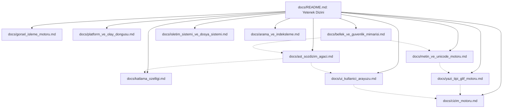

# Anthracite Mimari ve Yetenek (Skill) Dizini

Bu dizin, **Anthracite** yerel Markdown bilgi yönetim sistemi ve metin editörünün çekirdek mimarisini, her bir alt sistem için bağımsız birer uzmanlık rehberi (**Skill**) olarak modeller. Tüm belgeler %100 Türkçe hazırlanmış olup, hem insan geliştiriciler hem de otonom yapay zeka ajanları için kesin referans teşkil eder.

---

## 1. Temel Sistem Felsefesi ve Kurallar

Anthracite, hiçbir harici widget veya çalışma zamanı çerçevesine (GTK, Qt, Electron, WebKit, libcairo vb.) dayanmadan; doğrudan işletim sistemi çekirdeği (POSIX), X11 protokolü ve modern OpenGL (Core Profile) üzerinde çalışan, matematiksel doğruluğu formel olarak kanıtlanabilir saf bir yerel uygulamadır.

* **Programlama Dili:** **ATS2 (Applied Type System 2 - Postiats 0.4.2)**
* **Tip Güvenliği:** Bağımlı tipler (dependent types), doğrusal mantık (`linear types / view@`) ve kanıt tipleri (`proofs`) ile sıfır bellek sızıntısı ve sıfır tanımsız davranış (UB).
* **Güvenlik Değişmezi:** `./build/anthracite --selftest` çıktısında `live=1530113` değişmezi tam olarak korunur.
* **Fonksiyon Sınırları:** Tek Sorumluluk Prensibi (SRP) gereği fonksiyonlar $\le 20$ satırdır; tüm özyinelemeler sonlanma metrikleri (`.<recfuel>.`) ve `airlock_nat(MAX_REC_FUEL)` yakıt sayaçları ile sınırlıdır.

---

## 2. Modüler Yetenek (Skill) Haritası

---

## 3. Alt Sistem Yetenek Kılavuzları

| Yetenek Dosyası | İlgili Kod Dizini | Kapsadığı Temel Özellikler |
| :--- | :--- | :--- |
| **[1. Katlama Özelliği](file:///home/emrehan/kod/kod/anthracite/docs/katlama_ozelligi.md)** | `src/data_ast/fold_region.*` | FRT (Fold Region Table), hiyerarşik başlık sınırları ($H_1..H_6$), görsel sütun girintisi, yaprak liste filtreleme, durum izolasyonu (`folds` vs `hidden`), monotonik süpürme, Alt+Tık derin katlama. |
| **[2. AST ve Sözdizim Ağacı](file:///home/emrehan/kod/kod/anthracite/docs/ast_sozdizim_agaci.md)** | `src/data_ast/` | Markdown blok ve satır içi ayrıştırıcı (`NodeKind`), `Doc_` veri yapısı, gap buffer, satır ofset dizini, artımlı ayrıştırma (`ast_reparse_v2`), yerleşim motoru (`layout_engine`). |
| **[3. Kullanıcı Arayüzü (UI)](file:///home/emrehan/kod/kod/anthracite/docs/ui_kullanici_arayuzu.md)** | `src/ui_workspace/` | RAD Debugger esintili anında çizim mimarisi, `ui_widgets` bileşen seti (`ui_cell`, `ui_code_slice`, `ui_pane`, `ui_scroll_bar`), Top Bar, dinamik Split View, yeniden boyutlandırılabilir Sidebar, iki katmanlı FSM (`editor_fsm`, `embed_fsm`), 55+ komut ve yumuşak sarma (soft wrap) görsel gezinmesi. |
| **[4. Çizim Motoru (Render)](file:///home/emrehan/kod/kod/anthracite/docs/cizim_motoru.md)** | `src/core_render/` | Modern OpenGL (Core Profile), GLX/EGL bağlamı, V-Sync, VBO/VAO/EBO yönetimi, GLSL shader'ları, 2D ilkel çizimler, glif atlası ve doku bağlama, toplu çizim (batching). |
| **[5. Metin ve Unicode Motoru](file:///home/emrehan/kod/kod/anthracite/docs/metin_ve_unicode_motoru.md)** | `src/data_text/` | Katı UTF-8 çözme, Unicode 18 veritabanı, Genişletilmiş Grafem Kümesi (UAX #29), Kelime Sınırları, Satır Kesme (UAX #14), Dört Normalizasyon formu (NFC/NFD/NFKC/NFKD), Çift Yönlü Metin (UAX #9 Bidi). |
| **[6. Yazı Tipi ve Glif Motoru](file:///home/emrehan/kod/kod/anthracite/docs/yazi_tipi_glif_motoru.md)** | `src/data_font/` | Saf ATS2 SFNT / TTF / OTF tablo okuyucuları, Harf Biçimlendirme Hattı (Shaping Pipeline), GSUB (Ligatürler), GPOS (Kerning, Mark konumlandırma), Arapça harf birleştirme FSM'si. |
| **[7. Görsel İşleme Motoru](file:///home/emrehan/kod/kod/anthracite/docs/gorsel_isleme_motoru.md)** | `src/data_image/` | Saf ATS2 PNG, BMP, JPEG bayt akışı ayrıştırıcıları, zlib / DEFLATE açıcı, Huffman, IDCT ve renk dönüşümleri, bellek güvenli bilinear yeniden boyutlandırma, OpenGL doku önbelleği. |
| **[8. Platform ve Olay Döngüsü](file:///home/emrehan/kod/kod/anthracite/docs/platform_ve_olay_dongusu.md)** | `src/core_platform/`, `src/core_runtime/` | X11 protokolü ve Xlib olay kuyruğu, pencere yönetimi, `%0 CPU` boşta tüketim için `select`/`poll` bloke soket dinleme döngüsü, olay yönlendirme, `application_run` ve selftest orkestrasyonu. |
| **[9. Bellek ve Güvenlik Mimarisi](file:///home/emrehan/kod/kod/anthracite/docs/bellek_ve_guvenlik_mimarisi.md)** | `src/mem.*`, `src/airlock.*` | Doğrusal bellek tamponları (`Buf`), `view@` ve sahiplik aktarımı, Airlock sınır kapıları, `MAX_REC_FUEL` yakıt sayaçları, sonlanma metrikleri, `live=1530113` sızıntısız yaşam döngüsü güvencesi. |
| **[10. Sanal Dosya Sistemi (VFS)](file:///home/emrehan/kod/kod/anthracite/docs/isletim_sistemi_ve_dosya_sistemi.md)** | `src/os/` | VFS katmanı, RAM-FS bellek içi dosyalama, otomatik arka plan kaydetme (autosave), disk G/Ç senkronizasyonu, atomik dosya kaydetme, yapılandırılmış tanılama ve loglama (`diag.*`). |
| **[11. Arama ve İndeksleme](file:///home/emrehan/kod/kod/anthracite/docs/arama_ve_indeksleme.md)** | `src/search/` | Ripgrep (`rg`) proses entegrasyonu, asenkron çalışma alanı araması, doküman içi hızlı arama (`ix_match`), arama paneli UI entegrasyonu ve eşleşme navigasyonu. |

---

## 4. Geliştirici ve Ajan Kullanım Kılavuzu

Bir özellik üzerinde çalışırken veya hata ayıklama yaparken:
1. İlgili modülün skill dosyasını inceleyin.
2. `skill.md` dosyasındaki katı kod yazım kurallarına (SRP $\le 20$ satır, airlock sınırları, sonlanma sayaçları) harfiyen uyun.
3. Her değişiklik sonrası mutlaka `./build/anthracite --selftest` çalıştırarak bellek değişmezini (`live=1530113`) ve `ctest --test-dir build --output-on-failure` ile 77 testin tamamını doğrulayın.
