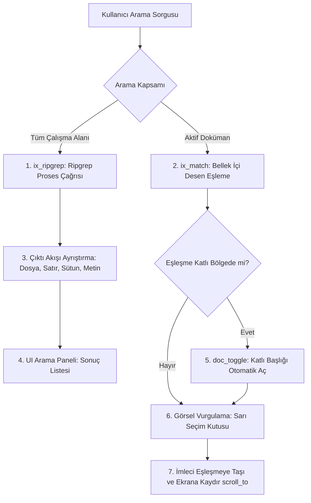

# Ripgrep Entegrasyonu ve Metin Arama Yeteneği

## 1. Yetenek Özeti ve Sorumluluk Sınırları

Bu yetenek, Anthracite editöründe hem çalışma alanı genelinde (tüm Markdown dosyaları) hem de aktif açık doküman içerisinde yüksek hızlı, bellek dostu metin araması yapılmasını sağlar.

Çalışma alanı genelindeki aramalarda dünyanın en hızlı metin tarayıcısı olan **Ripgrep (`rg`)** alt süreç (subprocess) mimarisiyle entegre edilir; doküman içi aramalarda ise doğrudan bellek tamponu üzerinde katlama durumunu dikkate alan saf ATS2 eşleştirme motoru (`ix_match`) kullanılır.

### Temel Sorumluluklar
* **Çalışma Alanı Genel Arama (`ix_ripgrep`):** Ripgrep prosesi başlatma (`popen`/`pipe`), argüman paketleme, JSON veya satır bazlı çıktı akışını asenkron okuma ve sonuçları arama paneline besleme.
* **Doküman İçi Hızlı Arama (`ix_match`):** Aktif dokümanın gap buffer'ı üzerinde ileri ve geri yönlü hızlı desen eşleme ($O(N)$).
* **Katlama Duyarlı Arama (Fold-Aware Search):** Katlanmış (`collapsed / hidden`) başlıklar altındaki eşleşmeleri tespit etme ve kullanıcı eşleşmeye gittiğinde ilgili başlığı otomatik açma (`doc_toggle`).
* **Arama Paneli ve Navigasyon:** UI arama çekmecesindeki sonuçların listelenmesi, Enter ile sonraki eşleşmeye, Shift+Enter ile önceki eşleşmeye atlama, editörde eşleşen metnin sarı renkle vurgulanması.

---

## 2. Arama ve Eşleştirme Mimarisi



---

## 3. Modül Dosya Yapısı

* `src/search/ix_ripgrep.sats` & `ix_ripgrep.dats`: Ripgrep proses yönetimi, arama parametreleri, sonuç tamponu okuma.
* `src/search/ix_match.sats` & `ix_match.dats`: Doküman içi eşleştirici, katlama kontrolü (`doc_node_collapsed`), ileri/geri atlama.
* `src/search/ix_test.dats`: Arama motoru selftest senaryoları ve doğrulama testleri.

---

## 4. Temel Veri Tipleri ve Fonksiyon İmzaları

### A. Eşleşme Sonuç Yapısı (`SearchResult`)
```ats
vtypedef SearchMatch = @{
  file_path: string,    (* Eşleşen dosyanın yolu *)
  line_num: int,        (* Satır numarası (1-indeksli) *)
  col_num: int,         (* Sütun numarası (0-indeksli) *)
  byte_offset: int,     (* Karakter bayt ofseti *)
  match_len: int,       (* Eşleşen metnin uzunluğu *)
  line_text: string     (* Eşleşen satırın önizleme metni *)
}
```

### B. Çekirdek Arama API'si
```ats
(* Çalışma Alanı Ripgrep Araması *)
fun search_workspace_start(root: string, query: string): int
fun search_workspace_poll(b: !Buf): int
fun search_workspace_stop(): void

(* Doküman İçi Arama *)
fun doc_find_next(d: !Doc, query: string, start_off: int): int
fun doc_find_prev(d: !Doc, query: string, start_off: int): int
fun doc_find_all(d: !Doc, query: string, matches: &Buf >> _): int
```

---

## 5. Çekirdek Algoritmik Süreçler

### A. Ripgrep Süreç İletişimi (IPC)
1. Kullanıcı arama sorgusunu girdiğinde `search_workspace_start` çağrılır.
2. Komut satırı güvenli şekilde oluşturulur:
   ```bash
   rg --line-number --column --no-heading --color never --max-count 100 <query> <root>
   ```
3. `popen` ile proses açılır; arayüz donmasın diye çıktılar parça parça (`non-blocking read`) okunarak arama paneli listesine eklenir.

### B. Doküman İçi Katlama-Duyarlı Arama (`ix_match`)
Aktif dokümanda bir eşleşme bulunduğunda:
1. Eşleşmenin karakter ofseti (`off`) alınır.
2. Eşleşmenin bulunduğu satır ve bu satırı kapsayan AST başlık düğümleri kontrol edilir:
   ```ats
   if is_heading(k) andalso is_on(doc_node_collapsed(d, i)) andalso igt(off, st) then
     (* Eşleşme katlanmış bir başlığın gövdesi içinde! *)
   ```
3. Kullanıcı bu sonuca tıkladığında veya `find_next` ile üzerine geldiğinde:
   * Katlı olan ebeveyn başlık otomatik olarak açılır (`doc_toggle(d, i)`).
   * Yerleşim güncellenir (`d_bump_ver`, `doc_layout`).
   * Ekran kaydırılarak eşleşen kelime görünür alana ortalanır (`scroll_to_offset`).

---

## 6. Güvenlik, Performans ve Değişmezler

* **Komut Enjeksiyonu Koruması:** Kullanıcı girdisi ham kabuğa (shell) verilmeden önce özel karakterler (`"`, `$`, `\`, `;`, `&`) temizlenir veya doğrudan `execve` dizi parametreleri olarak güvenli aktarılır.
* **Büyük Dosya Güvenliği:** Doküman içi arama doğrudan gap buffer üzerinde byte-by-byte karşılaştırmayla çalışır; yeni string kopyaları oluşturulmaz, bellek tahsisi yapılmaz ($O(1)$ ek bellek).
* **Selftest Doğrulaması:** `./build/anthracite --selftest` içinde arama motoru doğrulanır:
  ```
  ui search=1 flow=1 h=16 chrome=1 files=1
  ```
  `live=1530113` değişmezi korunur.
