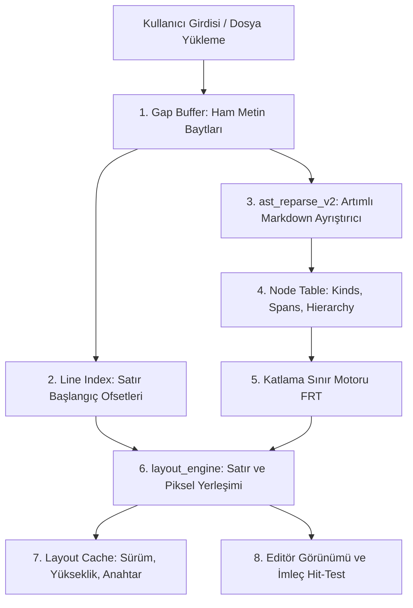

# Soyut Sözdizim Ağacı (AST) ve Doküman Modeli Yeteneği

## 1. Yetenek Özeti ve Sorumluluk Sınırları

Bu yetenek, Anthracite editöründe Markdown metinlerinin tip-güvenli Soyut Sözdizim Ağacı (AST) olarak ayrıştırılmasını, gap buffer üzerinde metin düzenlemelerinin yönetilmesini, satır ofsetlerinin haritalanmasını ve pencereli yerleşim (layout) hesaplamalarını üstlenir.

### Temel Sorumluluklar
* **Artımlı Ayrıştırma (Incremental Reparse):** Her tuş vuruşunda dosyanın tamamını baştan ayrıştırmak yerine, yalnızca değişen aralığı ve etkilenen blokları güncelleyen `ast_reparse_v2` motoru.
* **Metin Gap Buffer:** Karakter ekleme ve silme operasyonlarını $O(1)$ amortize karmaşıklıkla yürüten doğrusal tampon tabanlı metin omurgası.
* **Satır ve Düğüm Haritalama:** Karakter bayt ofsetleri ile satır numaraları arasında iki yönlü hızlı dönüşüm (`doc_line_of`, `doc_line_start`).
* **Yerleşim Motoru (`layout_engine`):** Yazı tipi satır yüksekliği (`lh`), metin sarma sütunu (`wc`), görsel satır adımı (`step`) ve dikey piksel koordinatlarının (`y`) önbelleklenmesi.

---

## 2. Mimari Model ve Veri Akışı



---

## 3. Modül Dosya Yapısı

* `src/data_ast/doc.sats`: Doküman çekirdek arayüzü, `Doc` soyut veri tipi, düğüm sorguları, metin manipülasyonu ve yaşam döngüsü.
* `src/data_ast/doc.dats`: `Doc_` iç yapısı, gap buffer işlemleri, bayt dizisi dönüşümleri, bellek tahsis ve serbest bırakma.
* `src/data_ast/layout_engine.dats`: Satır yükseklik hesabı, satır sarma (`doc_wrap_cols`), widget ve başlık dolgusu yerleşimi.
* `src/data_ast/layout_internal.sats`: Yerleşim tamponuna veri yazma ve okuma arayüzü (`doc_layout_store_line`, `doc_layout_line_hidden`).
* `src/data_ast/doc_visual.sats`: Görsel satır satır akış ve ekran koordinat dönüşümleri.

---

## 4. Düğüm Yapısı ve Tip İmzaları

### A. Düğüm Türleri (`NodeKind`)
```ats
(* Başlık Düğümleri *)
KH1, KH2, KH3, KH4, KH5, KH6

(* Blok Düğümleri *)
KPara      (* Düz Paragraf *)
KUl, KOl   (* Sırasız ve Sıralı Liste Konteyneri *)
KLi        (* Liste Maddesi *)
KCode      (* Fenced Kod Bloğu *)
KQuote     (* Blok Alıntı *)
KTable     (* Tablo *)
KFm        (* YAML Frontmatter *)
KHr        (* Yatay Çizgi / Ayırıcı *)

(* Satır İçi ve Özel Düğümler *)
KTask      (* Görev Kutusu: [ ] veya [x] *)
KImage     (* Görsel Referansı *)
KEmbed     (* Gömülü Nesne *)
KMathb     (* Matematik Bloğu LaTeX/KaTeX *)
KTag       (* Etiket: #etiket *)
```

### B. Düğüm Bellek Düzeni (Node Fields)
Her düğüm tamsayı alanlarından oluşan bir indeksle temsil edilir:
* `NF_KIND`: Düğümün çeşidi (`NodeKind`)
* `NF_START`: Düğümün başlangıç bayt ofseti
* `NF_END`: Düğümün bitiş bayt ofseti
* `NF_FLAGS`: Durum bayrakları (`FL_FOLDABLE = 1`, `FL_DIRTY = 2`)
* `NF_COLLAPSED`: Kullanıcının katlama durumu (1: kapalı, 0: açık)
* `NF_HIDDEN`: Üst katlamadan kaynaklanan görünmezlik durumu (1: gizli, 0: görünür)
* `NF_HEIGHT`: Düğümün piksel yüksekliği
* `NF_PARENT`, `NF_CHILD`, `NF_NEXT`: Hiyerarşik ağaç bağları

---

## 5. Çekirdek Algoritmik Süreçler

### A. Metin Gap Buffer ve Düzenleme Yönetimi
* Metin tamponu `gap_lo` ve `gap_hi` işaretçileri arasında esnek bir boşluk barındırır.
* Karakter eklendiğinde gap daralır; gap dolduğunda `buf_ensure` ile kapasite ikiye katlanır.
* Metin silindiğinde veya eklendiğinde `lines_apply_edit` ve `folds_apply_edit` fonksiyonları çağrılarak satır dizinleri ve katlama ofsetleri delta kaydırmasıyla güncellenir.

### B. Satır Yerleşim ve Adım Hesabı (`line_calc_step` - Monotonik İmleç ile $O(L + N)$)
```ats
fun line_calc_step(d: !Doc, line: int, nn: int, lh: int, is_read: int, wc: int, cur: &int >> _): int = let
  val hid = doc_is_line_hidden(d, line)
in
  if ieq(hid, 1) then 0
  else let
    val st = doc_line_start(d, line)
    val en = if ilt(iadd(line, 1), doc_nlines(d)) then doc_line_start(d, iadd(line, 1)) else doc_len(d)
    val rows = line_source_rows(d, line, wc)
    val () = cur := advance_node_cursor(airlock_nat(MAX_REC_FUEL), d, cur, nn, st)
    val @(extra, hpad) = line_scan_extras(airlock_nat(MAX_REC_FUEL), d, cur, nn, st, en, lh, is_read, 0, 0)
  in
    if ieq(is_read, 1) andalso igt(extra, 0) then iadd(extra, hpad)
    else iadd(iadd(imul(rows, lh), extra), hpad)
  end
end
```
* **Erken Çıkış (Early Exit):** Eğer satır katlanmış bir bölge içerisindeyse (`hid == 1`), `step` doğrudan **0** atanır; gereksiz AST düğüm taraması yapılmaz.
* **Monotonik Düğüm İmleci (`cur`):** Satır başlangıç ofseti `st` arttıkça, `cur` imleci `advance_node_cursor` ile sadece ileriye doğru sürülür ve `doc_node_start >= en` olduğunda arama `line_scan_extras` içinde anında kesilir. Bu sayede $O(L \times N)$ yerine $O(L + N)$ tek geçişli lineer yerleşim elde edilir (`söz.md` açılış süresi 0.2 saniyeye inmiştir).
* **Görünür Satır Ölçümü:** Kaynak metin satır sayısı (`rows * lh`), gömülü widget yüksekliği (`extra`) ve başlık boşlukları (`hpad`) toplanır.

### C. Yerleşim Önbellekleme (Layout Cache)
* `doc_layout_mode` fonksiyonu doküman sürümünü (`doc_ver`), satır yüksekliğini ve sarma sütununu birleştirerek önbellek anahtarı üretir.
* Doküman içeriği veya katlama durumu değişmediği sürece (`d_bump_ver` tetiklenmedikçe) yerleşim baştan hesaplanmaz; önbellekteki toplam yükseklik $O(1)$ sürede döndürülür.

---

## 6. Güvenlik ve Bellek Kuralları

* **Doğrusal Tip Güvenliği:** `Doc` yapısı doğrusal kanıt (`@DOC(s)`) ile sarmalanmıştır; doküman açıldığında (`doc_open`) tahsis edilir ve kapatıldığında (`doc_free`) altındaki tüm tamponlar (`gap`, `lines`, `nodes`, `lay`, `folds`, `regions`, `hidden`) sızıntısız serbest bırakılır.
* **Yakıt Koruması:** Ağaç tarama ve düğüm arama fonksiyonları (`find_line_owner_node_m`, `widget_h_m`, `line_heading_pad_m`) `MAX_REC_FUEL` sayaçları ile yığın taşmasına (stack overflow) karşı korunur.
