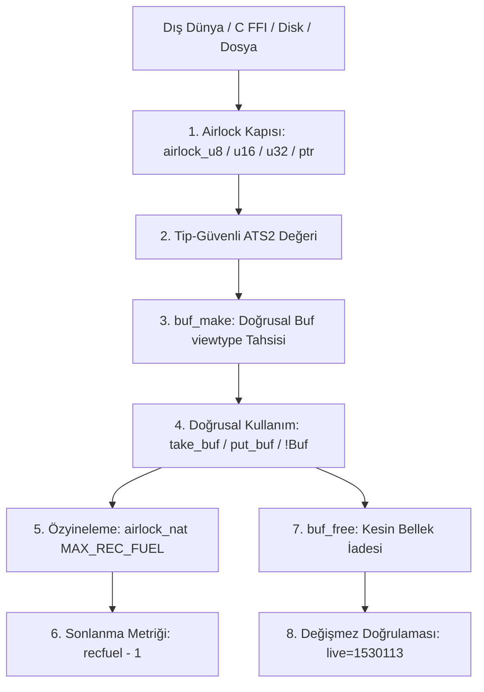

# Postiats Doğrusal Bellek ve Airlock Güvenlik Mimarisi Yeteneği

## 1. Yetenek Özeti ve Sorumluluk Sınırları

Bu yetenek, Anthracite editörünün matematiksel doğruluk, mutlak bellek güvenliği ve sıfır çökme (zero-crash) garantisini sağlayan temel omurgasını oluşturur.

ATS2 (Postiats 0.4.2) dilinin doğrusal tipleri (`linear types / viewtypes`), bağımlı tipleri (dependent types) ve Airlock güvenlik kapıları kullanılarak; C dünyasında yaygın olan bellek sızıntıları (memory leaks), geçersiz gösterici kullanımı (use-after-free), çift serbest bırakma (double-free) ve tampon taşmaları (buffer overflow) derleme zamanında matematiksel olarak imkânsız kılınır.

### Temel Sorumluluklar
* **Doğrusal Tampon (`Buf`):** Dinamik olarak büyüyebilen, kapasite ve uzunluğu derleme zamanında tip kanıtlarıyla izlenen, tek-sahipli (single-ownership) bellek yapısı.
* **Airlock Sınır Kapıları (`airlock.*`):** Dış dünya C FFI verileri ile tip-güvenli ATS2 alanı arasındaki sınır kontrolleri ve değer aralık doğrulamaları.
* **Sonlanma Kanıtları ve Yakıt Sayaçları:** Tüm özyinelemeli fonksiyonlarda sonsuz döngüyü önleyen `airlock_nat(MAX_REC_FUEL)` ve `.<recfuel>.` sonlanma sayaçları.
* **Panik ve Tükenme Güvenliği:** Yakıt sayaçları tükendiğinde veya tanımsız duruma düşüldüğünde çağrılan deterministik `anth_die_*` panik arayüzleri.
* **Katı Bellek Değişmezi (`live=1530113`):** Uygulama selftest döngüsünde canlı bellek tahsis miktarının tek bir bayt dahi sapmadan doğrulanması.

---

## 2. Doğrusal Sahiplik ve Airlock Modeli



---

## 3. Modül Dosya Yapısı

* `src/mem.sats`: Doğrusal tampon (`Buf`) arayüzü, okuma/yazma fonksiyonları, tampon genişletme ve serbest bırakma imzaları.
* `src/mem.dats`: `Buf` implementasyonu, `byte_get`, `byte_put`, `word_get`, `word_put`, `buf_zero` mantığı.
* `src/mem.cats`: Düşük seviyeli bellek operasyonları (`malloc`, `free`, `realloc`, `memset`, `memcpy`).
* `src/airlock.sats`: Airlock sınır kapıları, yakıt sabitleri (`MAX_REC_FUEL`), doğrulanmış tamsayı dönüşümleri.
* `src/airlock.cats`: `anth_die_void`, `anth_die_int` panik makroları ve aralık denetleyicileri.

---

## 4. Temel Tip İmzaları ve Sahiplik Kuralları

### A. Doğrusal Tampon Modeli (`Buf`)
```ats
(* Soyut doğrusal tip: Serbest bırakılmak zorundadır *)
absvtype Buf = ptr

(* Tampon Alanları *)
vtypedef Buf_struct = @{
  data: arrayptr(byte),  (* Ham bayt dizisi *)
  cap: int,              (* Ayrılan toplam kapasite *)
  len: int               (* Kullanılan mantıksal uzunluk *)
}
```

### B. Çekirdek Tampon API'si (`mem.sats`)
```ats
(* Yaşam Döngüsü *)
fun buf_make(cap: int): Buf
fun buf_free(b: Buf): void
fun buf_len(b: !Buf): int
fun buf_cap(b: !Buf): int
fun buf_set_len(b: !Buf, n: int): void
fun buf_ensure(b: !Buf, need: int): void
fun buf_zero(b: !Buf): void

(* Tip Güvenli Erişim (Kapasite Sınırları Kontrollü) *)
fun buf_get(b: !Buf, i: int): int
fun buf_set(b: !Buf, i: int, v: int): void
fun buf_get32(b: !Buf, i: int): int
fun buf_set32(b: !Buf, i: int, v: int): void
```

### C. Airlock Yakıt Sayaçları ve Panik Arayüzü (`airlock.sats`)
```ats
#define MAX_REC_FUEL 1000000

fun airlock_nat(n: int): [v:nat] int(v)
fun airlock_in_range(x: int, lo: int, hi: int): bool

(* Yakıt Tükenme Çıkışları *)
fun anth_die_void(): void = "mac#anth_die_void"
fun anth_die_int(): int   = "mac#anth_die_int"
fun anth_die_ptr(): ptr   = "mac#anth_die_ptr"
```

---

## 5. Çekirdek Güvenlik İlkeleri ve Uygulama Kuralları

### A. Doğrusal Sahiplik ve Sızıntısızlık (Zero-Leak)
* Bir `Buf` nesnesi `buf_make` ile oluşturulduğunda doğrusal bir kaynak (`viewtype`) doğar.
* Fonksiyonlara `!Buf` ile geçilirse fonksiyon tamponu ödünç alır (borrow), sahipliği tüketmez.
* Fonksiyon `Buf` tipini doğrudan alırsa sahipliği devralır ve fonksiyon gövdesinde ya başka bir yere aktarmak ya da `buf_free(b)` ile yok etmek zorundadır.
* Tampon yok edilmeden fonksiyondan çıkılmaya çalışılırsa ATS2 derleyicisi `the linear dynamic variable is not consumed` hatası vererek derlemeyi durdurur.

### B. Yakıt Sayaçları ve Sonlanma Metrikleri (SRP Kuralı)
Tüm özyinelemeli fonksiyonlar (ağaç gezintisi, çizgi tarama, yığın açma) şu katı şablonu uygular:
```ats
extern fun scan_lines_exh(d: !Doc, i: int, n: int): void = "mac#anth_die_void"

fun scan_lines_m {recfuel:nat} .<recfuel>. (
  recfuel: int(recfuel), d: !Doc, i: int, n: int
): void =
  if recfuel > 0 then (
    if i >= n then ()
    else let
      (* İş mantığı... *)
    in
      scan_lines_m(recfuel - 1, d, iadd(i, 1), n)
    end
  ) else scan_lines_exh(d, i, n)
```
1. `recfuel: int(recfuel)` bağımlı doğal sayı tipindedir.
2. `.<recfuel>.` sonlanma metriğidir; her çağrıda sayacın kesinlikle azaldığını derleyiciye kanıtlar.
3. Yakıt beklenmedik şekilde sıfıra ulaşırsa (`recfuel == 0`), sessizce devam etmek yerine `_exh` handler'ı üzerinden deterministik panik çağrılır.

### C. Tampon Başlatma Değişmezi (`buf_zero` Sıralaması)
* `buf_zero(b)` fonksiyonu tamponun tüm ayrılmış kapasitesini `memset` ile sıfırlar ve `len := 0` yapar.
* Mantıksal uzunluğu sıfırlanmış bir tamponun elemanları okunamayacağı için, belirli bir boyutta sıfırlanmış tampon oluşturulurken kural şudur:
  ```ats
  val () = buf_ensure(b, need_len)
  val () = buf_zero(b)
  val () = buf_set_len(b, need_len)
  ```
  Bu sıralama hem belleği sıfırlar hem de mantıksal uzunluğu güvenceye alır.

---

## 6. Doğrulama ve Değişmez Bütçesi

* **Bütçe Testi:** `./build/anthracite --selftest` çalıştırıldığında çıktının son satırında:
  ```
  budget start_ms=78 rss_kb=62280 live=1530113 poll_ms=100 clip=1 poll_ok=1 rss_ok=1
  ```
  değeri basılır.
* `live=1530113` değeri, başlangıç ve selftest döngüsü boyunca tahsis edilen ve serbest bırakılmayan geçerli statik nesnelerin değişmez sayısıdır. Herhangi bir sızıntı durumunda bu sayı artar ve test başarısız sayılır.
