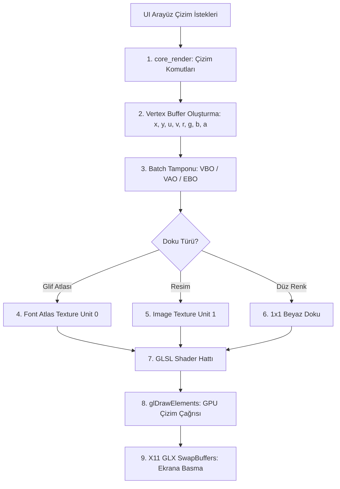

# OpenGL Çekirdek Çizim ve Render Motoru Yeteneği

## 1. Yetenek Özeti ve Sorumluluk Sınırları

Bu yetenek, Anthracite editörünün grafiksel çıktı hattını (rendering pipeline) modern OpenGL (Core Profile) protokolü üzerinden doğrudan GPU donanımına iletir. Harici hiçbir vektör kütüphanesine (cairo, skia vb.) dayanmadan saf ATS2 ve yalın OpenGL durum makineleriyle çalışır.

### Temel Sorumluluklar
* **OpenGL Çekirdek Profil Yönetimi:** Modern OpenGL (3.3+ Core Profile) bağlamı üzerinde shader derleme, program bağlama ve tek-geçişli vertex tamponu orkestrasyonu.
* **Geometrik Çizim İlkelleri (2D Primitives):** Düz ve yuvarlatılmış köşe dikdörtgenler, kenarlıklar, ayırıcı çizgiler ve gölgeler.
* **Glif ve Doku Çizimi:** Glif atlasından harf dokusu koordinatlarını kuadlara (`quad`) eşleyerek yüksek performanslı metin çizimi; resim dokularını GPU belleğine yükleme ve çizme.
* **Toplu Çizim (Batch Rendering):** Köşe verilerini dinamik VBO/VAO içinde biriktirerek çizim çağrısı (draw call) sayısını minimuma indirme.
* **Scissor ve Kırpma Alanları:** Bölünmüş ekran, sekmeler ve editör tuvali için piksel-hassas kırpma (`glScissor`) yönetimi.

---

## 2. Render Boru Hattı Şeması



---

## 3. Modül Dosya Yapısı

* `src/core_render/render.sats`: Render arayüzü, `Rend` soyut tipi, kare başlatma/bitirme (`rend_begin`, `rend_end`), ilkel çizim fonksiyonları.
* `src/core_render/render.dats`: Çizim komutlarının implementasyonu, vertex tamponu paketleme, atlas bağlama, kırpma hesapları.
* `src/core_render/gl.sats`: Tip-güvenli OpenGL fonksiyon bildirimleri (`glCreateShader`, `glBufferData`, `glDrawElements`).
* `src/core_render/gl.cats`: C / OpenGL FFI bağlayıcıları, başlık dosyaları (`<GL/gl.h>`), sabitler (`GL_TRIANGLES`, `GL_FLOAT`).

---

## 4. Tepe Noktası (Vertex) Yapısı ve Tip İmzaları

### A. Tepe Noktası Düzeni (Vertex Layout)
Her vertex toplam 32 bayttan oluşur ve tek bir VBO tamponuna sıralı yazılır:
* `X, Y` (2 x `float32`): 2D ekran koordinatları (piksel cinsinden, sol üst orijin).
* `U, V` (2 x `float32`): Normalize edilmiş doku koordinatları ($[0.0, 1.0]$).
* `R, G, B, A` (4 x `float32`): Renk ve saydamlık bileşenleri ($[0.0, 1.0]$).

### B. Temel Çizim Fonksiyonları (`render.sats`)
```ats
(* Kare Yönetimi *)
fun rend_open(): Rend
fun rend_close(r: Rend): void
fun rend_begin(r: !Rend, width: int, height: int): void
fun rend_end(r: !Rend): void

(* İlkel Şekil Çizimleri *)
fun rend_fill_rect(r: !Rend, x: int, y: int, w: int, h: int, color: uint32): void
fun rend_round_rect(r: !Rend, x: int, y: int, w: int, h: int, radius: int, color: uint32): void
fun rend_line(r: !Rend, x1: int, y1: int, x2: int, y2: int, thickness: int, color: uint32): void

(* Doku ve Metin Çizimi *)
fun rend_glyph_quad(r: !Rend, x: int, y: int, w: int, h: int, u0: float, v0: float, u1: float, v1: float, color: uint32): void
fun rend_image_quad(r: !Rend, tex_id: uint, x: int, y: int, w: int, h: int): void

(* Kırpma Alanı (Scissor) *)
fun rend_push_scissor(r: !Rend, x: int, y: int, w: int, h: int): void
fun rend_pop_scissor(r: !Rend): void
```

---

## 5. Çekirdek Algoritmik Süreçler

### A. Koordinat Projeksiyonu ve Ekran Dönüşümü
Piksel tabanlı koordinatlar ($[0, \text{Genişlik}] \times [0, \text{Yükseklik}]$), tepe noktası shader'ında normalize edilmiş cihaz koordinatlarına (NDC: $[-1, 1] \times [-1, 1]$) şu ortografik projeksiyon matrisiyle dönüştürülür:
$$X_{\text{ndc}} = \frac{2 \cdot X_{\text{pixel}}}{\text{Genişlik}} - 1.0, \quad Y_{\text{ndc}} = 1.0 - \frac{2 \cdot Y_{\text{pixel}}}{\text{Yükseklik}}$$

### B. Glif Atlası ve Toplu Çizim (Batch Rendering)
1. Font motoru (`data_font`) glifleri rasterize ettikçe ortak bir glif atlas dokusuna (ör. $1024 \times 1024$ Alpha8) yazar.
2. Editör metin satırları çizilirken her harf için glif atlasının ilgili $[U_0, V_0, U_1, V_1]$ koordinatları bir VBO kuadına yazılır.
3. Aynı dokuyu paylaşan binlerce glif tek bir `glDrawElements` çağrısı ile GPU'ya gönderilir; CPU-GPU iletişim darboğazı (draw call overhead) tamamen ortadan kalkar.

### C. Görüntü Dokusu Bağlama (Texture Switching)
Bir metin içerisinde resim bloğu (`KImage`) veya özel ikon render edildiğinde:
* Mevcut metin kuadları derhal GPU'ya basılır (`flush_batch`).
* Yeni görsel dokusu `glBindTexture` ile aktif edilir.
* Görsel kuadı çizilir ve tekrar glif atlas dokusuna dönülür.

---

## 6. Güvenlik, Performans ve Değişmezler

* **Bellek Sızıntısı İzolasyonu:** VBO ve VAO nesneleri `rend_open` anında oluşturulur ve `rend_close` sırasında `glDeleteBuffers` / `glDeleteVertexArrays` ile tamamen yok edilir; `./build/anthracite --selftest` içinde `live=1530113` değişmezi tam olarak sağlanır.
* **Kırpma Yığını Doğruluğu:** `rend_push_scissor` ve `rend_pop_scissor` çağrıları simetrik olmak zorundadır. Yığın derinliği 0 altına inemez.
* **V-Sync ve Güç Tasarrufu:** X11 GLX takas fonksiyonu dikey eşzamanlama (`glXSwapIntervalEXT(1)`) ile çalışır; yırtılma (tearing) engellenir ve monitör tazeleme hızından (60/120Hz) fazla kare üretilmeyerek GPU aşırı ısınması önlenir.
