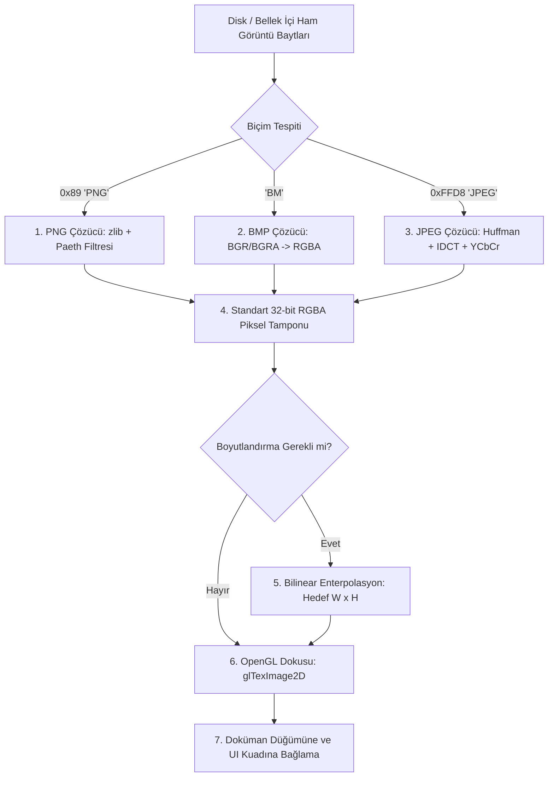

# Saf ATS2 Görüntü Çözümleme ve İşleme Yeteneği

## 1. Yetenek Özeti ve Sorumluluk Sınırları

Bu yetenek, Markdown dokümanlarında yer alan veya arayüzde kullanılan görsel dosyalarının (PNG, BMP, JPEG) bayt düzeyinde çözümlenmesini (decoding), piksellerin bellekte işlenmesini ve OpenGL dokularına dönüştürülmesini sağlar.

Sistemde `stb_image`, `libpng`, `libjpeg` gibi hiçbir harici C kütüphanesi kullanılmaz; tüm sıkıştırma açma (zlib/DEFLATE), Huffman kod çözme, ters kosinüs dönüşümü (IDCT) ve piksel yeniden boyutlandırma algoritmaları saf ATS2 doğrusal tipleri (`viewtype`) ile yazılmıştır.

### Temel Sorumluluklar
* **PNG Çözümleyici (`img_png.dats`):** PNG chunk ayrıştırma (IHDR, IDAT, IEND), zlib / DEFLATE açıcı, Paeth filtre tersine çevirme.
* **BMP Çözümleyici (`img_bmp.dats`):** Standart Windows BMP başlıkları (`BITMAPINFOHEADER`), 24-bit ve 32-bit sıkıştırmasız piksel çıkarımı.
* **JPEG Çözümleyici (`img_jpg.dats`):** JFIF formatı, Huffman tabloları, Quantization matrisleri, 8x8 blok IDCT (Inverse Discrete Cosine Transform) ve YCbCr'den RGB renk uzayına dönüşüm.
* **Piksel Yeniden Boyutlandırma (`img_resize.dats`):** Bilinear (çift doğrusal) enterpolasyon ile yüksek kaliteli piksel ölçekleme.
* **OpenGL Entegrasyonu:** Çözümlenen RGBA piksel tamponlarının GPU dokusuna (`glBindTexture`, `glTexImage2D`) aktarımı.

---

## 2. Görüntü Çözümleme Hattı (Pipeline)



---

## 3. Modül Dosya Yapısı

* `src/data_image/image.sats`: Görüntü veri tipi (`Image`), resim yükleme ve boyutlandırma arayüzü (`image_load`, `image_resize`).
* `src/data_image/image.dats`: Biçim tespiti, bellek tahsis ve serbest bırakma mantığı.
* `src/data_image/img_png.dats`: PNG çözücü ve DEFLATE algoritması implementasyonu.
* `src/data_image/img_bmp.dats`: BMP dosya başlık ve piksel tarama motoru.
* `src/data_image/img_jpg.dats`: JPEG SOF0 ayrıştırma, Huffman ağaçları ve IDCT matematik motoru.
* `src/data_image/img_resize.dats`: Çift doğrusal enterpolasyonlu piksel ölçekleme fonksiyonu.

---

## 4. Temel Veri Yapıları ve Fonksiyon İmzaları

### A. Görüntü Doğrusal Veri Modeli (`Image`)
```ats
vtypedef Image = @{
  width: int,        (* Piksel genişliği *)
  height: int,       (* Piksel yüksekliği *)
  channels: int,     (* 3: RGB, 4: RGBA *)
  pixels: Buf        (* Doğrusal ham piksel tamponu *)
}
```

### B. Temel Fonksiyon İmzaları (`image.sats`)
```ats
(* Görüntü Yükleme ve Çözme *)
fun image_load(path: string): Image
fun image_load_mem(data: !Buf, len: int): Image
fun image_free(img: Image): void

(* Geometrik İşlemler *)
fun image_width(img: !Image): int
fun image_height(img: !Image): int
fun image_resize(img: !Image, new_w: int, new_h: int): Image

(* OpenGL Dokusuna Dönüştürme *)
fun image_to_texture(img: !Image): uint
```

---

## 5. Çekirdek Algoritmik Süreçler

### A. PNG DEFLATE ve Paeth Filtresi
1. PNG `IDAT` chunk'larından gelen zlib akışı, LZ77 geriye dönük ofset-uzunluk eşleme ve dinamik Huffman ağaçları çözülerek ham baytlara açılır.
2. Her tarama satırı (scanline) bir filtre baytı ile başlar:
   * **None (0):** Değişiklik yok.
   * **Sub (1):** Sol komşuyu topla: $x + a$.
   * **Up (2):** Üst komşuyu topla: $x + b$.
   * **Average (3):** Sol ve üstün ortalamasını topla: $x + \lfloor (a + b) / 2 \rfloor$.
   * **Paeth (4):** $p = a + b - c$ formülüne en yakın komşuyu ($a, b, c$) tespit edip topla.
3. Filtresi çözülen pikseller RGBA tamponuna yazılır.

### B. JPEG IDCT ve Renk Dönüşümü
1. JPEG akışı `0xFFD8` (SOI) ile başlar; `0xFFC0` (SOF0) ile temel boyutlar ve bileşenler (Y, Cb, Cr) okunur.
2. Kuantalama tabloları (`DQT`) ve Huffman ağaçları (`DHT`) oluşturulur.
3. $8 \times 8$ bloklar halindeki frekans katsayıları zigzag sırasıyla okunur ve ters kuantalanır.
4. Ters Ayrık Kosinüs Dönüşümü (IDCT) işletilerek frekans uzayından uzamsal parlaklık ve renk değerleri çıkarılır.
5. $YC_bC_r$ renkleri standart formülle RGB'ye dönüştürülür:
   $$R = Y + 1.402 \cdot (C_r - 128)$$
   $$G = Y - 0.344136 \cdot (C_b - 128) - 0.714136 \cdot (C_r - 128)$$
   $$B = Y + 1.772 \cdot (C_b - 128)$$

### C. Bilinear (Çift Doğrusal) Ölçekleme
Görüntü boyutu $W_1 \times H_1$'den $W_2 \times H_2$'ye dönüştürülürken:
Her hedef piksel $(x', y')$ için kaynak koordinatları hesaplanır:
$$u = x' \cdot \frac{W_1 - 1}{W_2 - 1}, \quad v = y' \cdot \frac{H_1 - 1}{H_2 - 1}$$
Dört komşu pikselin ($P_{00}, P_{10}, P_{01}, P_{11}$) ağırlıklı ortalaması alınarak merdivenleşme (aliasing) olmaksızın pürüzsüz yeni piksel değeri üretilir.

---

## 6. Güvenlik, Bellek ve Değişmezler

* **Tampon Taşması Koruması:** Resim dosyası bozuk veya kırpılmış olduğunda dosya boyutunu aşan indeks erişimleri derhal hata ile sonlanır; asla tanımsız bellek okunmaz.
* **Bellek Değişmezi:** Resim piksellerini tutan `pixels` tamponu doğrusal sahiplik altındadır. Doküman kapatıldığında veya resim silindiğinde `image_free` çağrısı ile tampon serbest bırakılır; `./build/anthracite --selftest` içinde `live=1530113` değişmezi tam olarak korunur.
