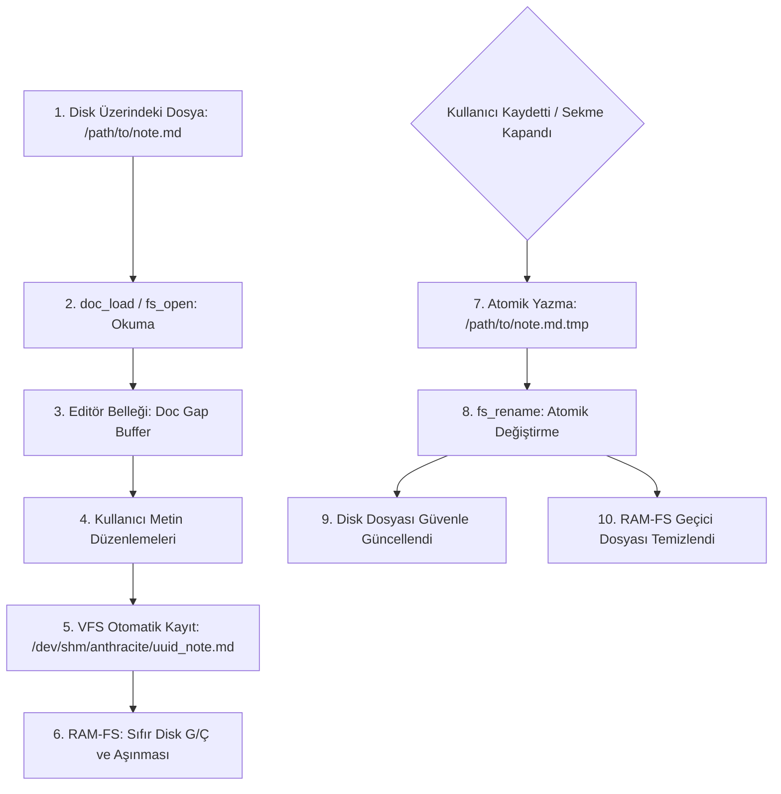

# Sanal Dosya Sistemi (VFS) ve Tanılama Yeteneği

## 1. Yetenek Özeti ve Sorumluluk Sınırları

Bu yetenek, Anthracite editörünün işletim sistemi dosya giriş/çıkış (G/Ç) işlemlerini, bellek-içi Sanal Dosya Sistemi (VFS / RAM-FS) mimarisini, veri kaybını önleyen atomik otomatik kaydetme (autosave) mekanizmasını ve yapılandırılmış tanılama (logging & diagnostics) sistemini yönetir.

### Temel Sorumluluklar
* **Sanal Dosya Sistemi (VFS):** Dokümanların disk yerine yüksek hızlı paylaşımlı bellek alanında (`/dev/shm/anthracite/` veya `/tmp/`) tutulması; disk yıpranmasının ve G/Ç gecikmesinin sıfırlanması.
* **Otomatik ve Atomik Kaydetme:** Düzenleme esnasında RAM-FS üzerine periyodik otomatik kayıt; kullanıcı kaydettiğinde veya dosya kapatıldığında diske atomik geçici dosya (`.tmp`) üzerinden taşıma (`rename`).
* **Güvenli Dosya Tanımlayıcıları (POSIX FS):** Dosya açma (`fs_open`), tampon okuma (`fs_read_buf`), yazma (`fs_write`) ve dosya boyutu sorgulama (`fs_size`) işlemlerinin sızıntısız yönetimi.
* **Yapılandırılmış Tanılama (Diagnostics & Logging):** Dosya adı, satır numarası ve ciddiyet derecesi (`[INFO]`, `[ERROR]`, `[WARN]`) içeren, prodüksiyonda ve selftest'te izlenebilirlik sağlayan günlükleme motoru.

---

## 2. VFS ve Dosya Yaşam Döngüsü Mimarisi



---

## 3. Modül Dosya Yapısı

* `src/os/fs.sats`: POSIX dosya erişim arayüzü (`fs_open`, `fs_close`, `fs_read_buf`, `fs_write`, `fs_size`).
* `src/os/fs.cats`: C POSIX sistem çağrıları (`open`, `read`, `write`, `close`, `stat`, `unlink`, `rename`).
* `src/os/vfs.sats` & `vfs.dats`: RAM-FS dizini yönetimi, geçici dosya adlandırma, VFS otomatik kaydetme ve disk senkronizasyonu.
* `src/os/diag.sats` & `diag.dats`: Yapılandırılmış loglama motoru (`log_info`, `log_warn`, `log_error`), biçimlendirme ve hata ayıklama çıktıları.
* `src/os/diag.cats`: Zaman damgası (`clock_gettime`) ve konsol çıktı yardımcıları.

---

## 4. Temel Veri Tipleri ve Fonksiyon İmzaları

### A. Dosya Erişim Bayrakları ve Modları
```ats
#define FS_READ 0
#define FS_WRITE 1
#define FS_CREATE 2
```

### B. Çekirdek Dosya API'si (`fs.sats`)
```ats
fun fs_open(path: string, mode: int): int
fun fs_close(fd: int): void
fun fs_read_buf(fd: int, b: !Buf, max_bytes: int): int
fun fs_write_buf(fd: int, b: !Buf, n_bytes: int): int
fun fs_size(path: string): int
fun fs_unlink(path: string): int
fun fs_rename(oldpath: string, newpath: string): int
```

### C. VFS Otomatik Kaydetme API'si (`vfs.sats`)
```ats
fun vfs_init(): void
fun vfs_ram_path(actual_path: string): string
fun vfs_save_to_ram(d: !Doc, actual_path: string): bool
fun vfs_sync_to_disk(d: !Doc, actual_path: string): bool
fun vfs_cleanup_ram(actual_path: string): void
```

### D. Tanılama ve Loglama API'si (`diag.sats`)
```ats
fun log_info(module: string, msg: string): void
fun log_warn(module: string, msg: string): void
fun log_error(module: string, msg: string): void
```

---

## 5. Çekirdek Algoritmik Süreçler

### A. RAM-FS Öncelikli Otomatik Kayıt (Zero Disk Wear)
1. Uygulama başladığında `/dev/shm/anthracite/` dizini kontrol edilir; mevcut değilse oluşturulur. Erişilemezse `/tmp/` dizinine düşülür.
2. Her dosya için yolun hash'i veya oturum UUID'si ile benzersiz bir RAM-FS yolu üretilir:
   $$\text{ram\_path} = \text{"/dev/shm/anthracite/"} + \text{hash}(\text{path}) + \text{"\_"} + \text{basename}(\text{path})$$
3. Düzenleme yapıldıkça metin doğrudan RAM tamponundan bu dosyaya yazılır; işlem mikrosaniye mertebesinde tamamlanır, disk diskinin ömrü korunur ve takılma (lag) yaşanmaz.

### B. Atomik Diske Yazma (Atomic Disk Save)
Elektrik kesintisi veya ani çökme anında dosyanın bozulmasını (file corruption) önlemek için:
1. Veriler doğrudan orijinal dosyanın üzerine yazılmaz.
2. Önce aynı dizinde geçici dosya açılır: `/path/to/note.md.tmp`.
3. Veriler tamamıyla bu geçici dosyaya yazılır ve `fs_sync` çağrılır.
4. İşletim sisteminin atomik `rename` sistem çağrısı (`fs_rename`) ile geçici dosya orijinal dosyanın yerine geçirilir.
5. Dosya ya tamamen eski halindedir ya da tamamen yeni halindedir; yarım yazılma riski $0$'dır.

### C. Yapılandırılmış Loglama Formatı
Tüm log kayıtları şu standart biçimde konsola ve tanı dosyasında toplanır:
```
[INFO] [/home/.../diag_dats.c:453] [DOC] load_ok: /path/to/file.md
[INFO] [/home/.../image_dats.c:5364] [IMAGE] loaded successfully: /tmp/image.png
[ERROR] [/home/.../fs.c:120] [FS] file open failed: /invalid/path
```

---

## 6. Güvenlik, Hata Yönetimi ve Değişmezler

* **Dosya Tanımlayıcı Sızıntısı Yasağı (FD Leak):** Açılan her dosya tanıtıcısı (`fd >= 0`), işlem başarılı olsun veya olmasın `try-finally` eşdeğeri ATS2 guard blokları içinde kapatılır (`fs_close(fd)`).
* **Selftest Doğrulaması:** `./build/anthracite --selftest` içinde:
  ```
  vfs_autosave=1 in_ram=1 close_disk=1
  ```
  kontrolleri çalıştırılır; RAM-FS'e yazma, diskle senkronize etme ve geçici dosyayı temizleme döngüsü doğrulanır.
* **Bellek Değişmezi:** VFS ve tanılama tamponları statik tahsisat ve doğrusal string yapılarıyla yönetilir; `live=1530113` değişmezi tam olarak korunur.
