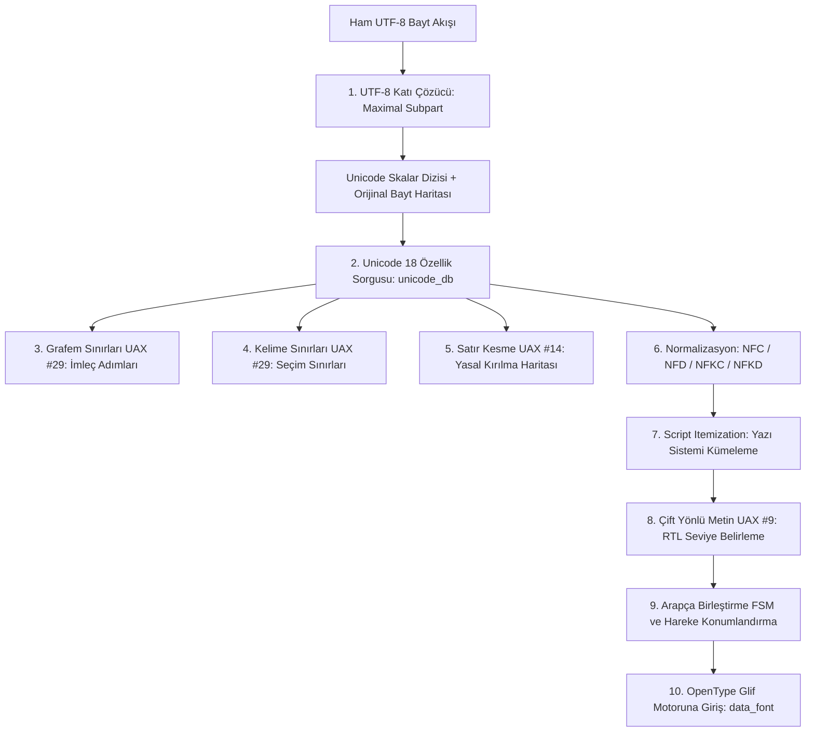

# Yerel Metin, Unicode 18 ve Çift Yönlü (Bidi) Metin Yeteneği

## 1. Yetenek Özeti ve Sorumluluk Sınırları

Bu yetenek, Anthracite editöründe metin akışının evrensel standartlarda (Unicode 18.0) çözümlenmesini, harf/kelime/satır sınırlarının belirlenmesini, dört normalizasyon formunun uygulanmasını, çift yönlü (çift yönlü - Arapça/İbranice RTL ve Latin LTR) metin yerleşimini ve yazı sistemi kümelemesini (script itemization) saf ATS2 (Postiats 0.4.2) ile sağlar.

`src/data_text/` dizini altında yer alan **205 bağımsız kaynak dosyası**, katı tip güvenliği ve tek sorumluluk prensibi (SRP $\le 128$ satır/dosya) gereği 9 mantıksal mimari modül grubuna ayrılmıştır. Harici hiçbir işletim sistemi veya üçüncü taraf kütüphanesine (HarfBuzz, FreeType, ICU, Pango, FriBidi vb.) bağımlılık bulunmaz; tüm algoritmalar resmi Unicode 18 test paketleriyle doğrulanmış saf fonksiyonel ve doğrusal tiplerle inşa edilmiştir.

### Temel Sorumluluklar
* **Katı UTF-8 Kod Çözümü:** Geçersiz bayt dizilerini W3C/Unicode standardına uygun olarak "Maximal Subpart Replacement" kuralıyla $U+FFFD$ yerine koyarak çözme ve orijinal bayt haritasını koruma.
* **Unicode 18 Veritabanı:** Resmi veri dosyalarından derlenmiş, glif özellikleri, birleştirme sınıfları ve yönlülük kategorilerini içeren dahili veri tabanı.
* **Grafem Kümeleri (UAX #29):** Emojiler, birleşik karakterler ve ZWJ (Zero-Width Joiner) dizilerini tek bir görsel imleç adımı (Extended Grapheme Cluster) olarak gruplama.
* **Kelime Sınırları (UAX #29):** Çift tıklama seçimi ve Ctrl+Sağ/Sol navigasyonu için sözcük sınırlarını kesin kurallarla belirleme.
* **Satır Kesme Algoritması (UAX #14):** 19.346 resmi test durumunu geçen, dile özgü tireleme ve bağlamsal noktalama kurallarını içeren yasal satır kırılma motoru.
* **Dört Normalizasyon Formu (UAX #15):** NFC, NFD, NFKC, NFKD standartlarını kanonik ayrıştırma, kompozisyon dışlama ve algoritmik Hangul birleştirme ile uygulama.
* **Çift Yönlü Metin Motoru (UAX #9 Bidi):** Soldan sağa (LTR) ve sağdan sola (RTL) metinlerin aynı satırda doğru görsel sırada görüntülenmesi ve imleç navigasyonu.
* **Arapça Harf Birleştirme ve Hareke Motoru:** Arap alfabesinde harflerin komşularına göre aldığı 4 formu (İzole, Başlangıç, Orta, Bitiş) belirleyen FSM ve hareke kanonik sıralaması.
* **Yazı Sistemi Kümeleme (Script Itemization):** Metni alfabelere göre (Latin, Arapça, Kiril, Çince vb.) homojen biçimlendirme koşularına (shaping runs) bölme.

---

## 2. Metin İşleme Hattı (Pipeline)



---

## 3. Gerçek Dosya Yapısı ve Mantıksal Modül Grupları

`src/data_text/` dizinindeki 205 dosya, kod tabanında düz bir dizin içinde yer almakta olup, mimari olarak şu 9 uzmanlık modülünde gruplanmıştır:

```
src/data_text/
├── [Grup 1: UTF-8 Çözümleme]             (utf8*.sats/dats)                -> 7 dosya
├── [Grup 2: Unicode 18 Veritabanı]       (unicode_*, property_*, category*) -> 11 dosya
├── [Grup 3: Grafem Kümeleri]              (grapheme*, source_grapheme*)     -> 4 dosya
├── [Grup 4: Kelime Sınırları]             (word_*.sats/dats)                -> 5 dosya
├── [Grup 5: Satır Kesme Algoritması]     (line_*.sats/dats)                -> 32 dosya
├── [Grup 6: Normalizasyon Formları]       (normalization_*.sats/dats)       -> 40 dosya
├── [Grup 7: Çift Yönlü Metin (BiDi)]     (bidi_*.sats/dats)                -> 46 dosya
├── [Grup 8: Arapça Birleştirme ve Hareke] (arabic_join_*, arabic_marks_*)   -> 20 dosya
└── [Grup 9: Yazı Sistemi ve Metin Akışı] (script_*, text_source*, text_fields*) -> 40 dosya
```

---

## 4. Modüllerin Ayrıntılı Teknik İncelemesi

---

### MODÜL 1: UTF-8 Kod Çözümleme ve Sahiplik Modülü
Bu modül, dış dünyadan gelen ham bayt akışını katı Unicode 18 skalar değerlerine ($U+0000 \dots U+10FFFF$, surrogates $U+D800 \dots U+DFFF$ hariç) dönüştürür.

#### Dosya Listesi (7 Dosya)
* `utf8.sats` & `utf8.dats`: Çekirdek UTF-8 API'si, skalar akışı çözme (`utf8_decode_all`), bayt dizisi uzunluğu ve doğrusal dizi sahipliği.
* `utf8_scalar.dats`: Tekil Unicode skalar değerlerinin bayt dizisinden okunması, 1-4 bayt aralık doğrulaması.
* `utf8_step.dats`: Kod çözme adım mantığı, Maximal Subpart Replacement kuralları, geçersiz sekanslarda $U+FFFD$ ikamesi.
* `utf8_measure.dats`: Bellek ayırmadan önce kaynak metindeki toplam skalar sayısını hesaplayan ön ölçüm geçişi ($O(N)$ bellek tahsis optimizasyonu).
* `utf8_store.dats`: Çözülen skalar değerlerin ve bunlara karşılık gelen orijinal bayt aralıklarının (`start_byte`, `end_byte`) tampon dizilerine yazılması.
* `utf8_window.dats`: Metin penceresi üzerinde kaydırmalı bayt okuma ve sınır kontrolleri.
* `utf8_work.sats`: Dahili UTF-8 yardımcı tipleri ve fonksiyon imzaları.

#### Algoritmik Süreç ve Güvenlik
* **Maximal Subpart Replacement:** Standart dışı bozuk bayt dizilimlerinde (örneğin UTF-8 ön eki olup ardılı eksik olan baytlar), tüm hatalı sekans tek bir karaktere dönüştürülmez. W3C ve Unicode standartlarına uygun olarak en uzun geçerli ön-ek tespit edilir ve yalnızca o alt parça $U+FFFD$ ile ikame edilir.
* **Orijinal Bayt Haritası:** Editörde imleç hareketi ve metin seçimi yapıldığında, skalar indeks doğrudan kaynak dosyadaki bayt ofsetine haritalanır; UTF-8 çok-baytlı yapısı şeffafça korunur.

---

### MODÜL 2: Unicode 18 Özellik ve Veritabanı Modülü
Bu modül, Unicode Standart Sürüm 18 resmi veri tablolarından üretilmiş özellik sorgu motorudur.

#### Dosya Listesi (11 Dosya)
* `unicode_db.sats` & `unicode_db.dats`: Unicode 18 resmi veritabanı arayüzü; skalar kodların genel kategori (General_Category), Bidi sınıfı, satır kesme sınıfı ve birleştirme tipi sorguları.
* `unicode_property.sats` & `unicode_property.dats`: Tür-indeksli (kind-indexed) özellik haritaları, `@missing` varsayılan değerleri.
* `unicode_sort.sats` & `unicode_sort.dats`: Skalar anahtarlarla kararlı Radix sıralama ve ikili arama (`bsearch`) optimizasyonu.
* `property_symbols.sats` & `property_symbols.dats`: Unicode özellik sembolleri ve enum/tamsayı eşleme tabloları.
* `property_source.sats` & `property_source.dats`: Kaynak Unicode metin tablolarının taranması ve doğrulanması.
* `property_writer.sats` & `property_writer.dats`: Derlenmiş ikili özellik tablolarının oluşturulması.
* `category_property_symbols.dats`: Unicode Genel Kategori (Lu, Ll, Nd, Po, Zs vb.) sembol tanımları.

#### Algoritmik Süreç ve Güvenlik
* **Bağımsızlık:** Ne işletim sisteminin ne de Python ortamının Unicode kütüphanesine güvenilir. Resmi veriler `tools/unicode_compile.dats` ile ATS2 ikili veri dizilerine dönüştürülür ve SHA-256 kontrolüyle sabitlenir.
* **Kompakt Arama:** Skalar aralıklar sıralı dizilerde tutulur; özellik sorguları $O(\log N)$ ikili arama ile nanosaniyeler mertebesinde yanıtlanır.

---

### MODÜL 3: Grafem Kümeleri Modülü (UAX #29)
Kullanıcının gördüğü tek bir görsel karakteri (örneğin bir bayrak emojisi veya birleşik harf) oluşturan skalar dizisini belirler.

#### Dosya Listesi (4 Dosya)
* `grapheme.sats` & `grapheme.dats`: UAX #29 Genişletilmiş Grafem Kümesi (Extended Grapheme Cluster) algoritması, `GB9c` kuralı (Consonant + Virama/Linker + Consonant).
* `source_grapheme.sats` & `source_grapheme.dats`: Kaynak metin üzerinde karakter karakter ilerleyerek imleç adımlarını (`grapheme_next`, `grapheme_prev`) hesaplayan motor.

#### Algoritmik Süreç ve Güvenlik
* **Görsel İmleç Adımı:** Editörde sağ/sol ok tuşlarına basıldığında veya Backspace ile silme yapıldığında, karakter bir emoji ve cilt tonu birleşimiyse (ör. `👨` + `ZWJ` + `🔬` = `👨‍🔬`), imleç emojiyi parçalamaz; tek bir grafem olarak atlar veya siler.
* 853 resmi `GraphemeBreakTest` test durumunun tamamı sıfır hatayla doğrulanmıştır.

---

### MODÜL 4: Kelime Sınırları Modülü (UAX #29)
Metin üzerinde çift tıklama yapıldığında seçilecek sözcük sınırlarını ve Ctrl+Sol/Sağ kelime atlama mantığını yürütür.

#### Dosya Listesi (5 Dosya)
* `word_types.sats`: Kelime kesme sınıfları (`WB_ALetter`, `WB_Numeric`, `WB_ExtendNumLet`, `WB_Katakana`, `WB_HebrewLetter`, `WB_MidNum` vb.).
* `word_predicates.sats` & `word_predicates.dats`: Karakter sınıfı yüklemeleri, sayısal ve alfabetik birleşme kuralları.
* `word_rules.sats` & `word_rules.dats`: UAX #29 resmi durum geçiş kuralları (WB1-WB17).
* `word_state.dats`: Kelime sınırı sonlu durum makinesi (FSM) geçiş durumu.
* `word_segment.dats`: Metin üzerinde kelime aralıklarını (`[word_start, word_end)`) çıkaran motor.

#### Algoritmik Süreç ve Güvenlik
* 1.944 resmi `WordBreakTest` testi geçer. Kesme işaretleri (`it's`), ondalık sayılar (`3.14`) ve programlama değişkenleri (`user_name`) sözdizimsel kurallara uygun olarak tek bir kelime bloğu olarak tespit edilir.

---

### MODÜL 5: Satır Kesme Algoritması Modülü (UAX #14)
Metin sütun genişliğini aştığında metnin hangi noktalardan güvenle kırılabileceğini (Line Breaking Opportunities) hesaplar.

#### Dosya Listesi (32 Dosya)
* **Çekirdek Tipler ve Motor:**
  - `line_types.sats`: 43 resmi UAX #14 sınıfı (`LB_BK`, `LB_CR`, `LB_LF`, `LB_CM`, `LB_SP`, `LB_AL`, `LB_NU`, `LB_QU`, `LB_WJ` vb.).
  - `line_engine.sats` & `line_engine.dats`: Satır kesme yürütme motoru ve orkestrasyon.
  - `line_break_map.sats` & `line_break_map.dats`: Metin ofsetleri için kesme haritası (`LB_MANDATORY`, `LB_ALLOWED`, `LB_PROHIBITED`).
  - `line_class.dats`: Karakterden satır kesme sınıfını çıkaran sınıflandırıcı.
  - `line_context.sats` & `line_context.dats`: Satır kesme bağlam yığını ve durum takibi.
  - `line_decide.dats`: İki karakter arasındaki kesme kararını veren nihai hakem fonksiyonu.
  - `line_groups.sats` & `line_groups.dats`: Karakter sınıf gruplamaları.
  - `line_source.sats` & `line_source.dats`: Skalar metin kaynağı akışı.
  - `line_tokens.sats`, `line_tokens_build.dats`, `line_tokens_storage.dats`: Satır kesme token dizilerinin inşası ve depolanması.
  - `line_property_symbols.sats` & `line_property_symbols.dats`: Satır kesme sembol dönüştürücüleri.
* **Yüklem Aileleri (Predicates):**
  - `line_predicates.sats`: Yüklem arayüzleri.
  - `line_predicates_alphabetic.dats`: Alfabetik karakter yüklemleri.
  - `line_predicates_controls.dats`: Kontrol karakterleri ve satır sonları (CR, LF, BK).
  - `line_predicates_emoji.dats`: Emoji ve genişletilmiş resim sembolleri.
  - `line_predicates_hyphens.dats`: Tireler ve heceleme işaretleri (HY, BA, BB).
  - `line_predicates_numeric.dats`: Sayılar ve sayısal birleştiriciler (NU, PR, PO, IS).
  - `line_predicates_punctuation.dats`: Noktalama ve parantezler (CL, CP, OP, QU).
  - `line_predicates_resolution.dats`: Çakışma çözümleme yüklemleri.
  - `line_predicates_spacing.dats`: Boşluklar ve görünmez ayrıcılar (SP, ZW).
  - `line_predicates_syllables.dats`: Brahmic ve Doğu Asya hece yüklemleri.
* **Kural Modülleri (Rules):**
  - `line_rules.sats`: Kural protokolü.
  - `line_rules_hard.dats`: Zorunlu kesme kuralları (LB4-LB6).
  - `line_rules_numbers.dats`: Sayısal kesme kuralları (LB23-LB25).
  - `line_rules_punctuation.dats`: Noktalama kuralları (LB13-LB18).
  - `line_rules_quotes.dats`: Tırnak işaretleri kuralları (LB19).
  - `line_rules_syllables.dats`: Heceleme kuralları (LB26-LB30).
  - `line_rules_words.dats`: Alfabetik kelime kuralları (LB20-LB22).

#### Algoritmik Süreç ve Güvenlik
* 19.346 resmi `LineBreakTest` test durumunun tamamı dengeli tampon sahipliğiyle geçer.
* Birleşik karakterler (`CM`) `LB9/LB10` ile temel karaktere yapıştırılır; bağlamsal FSM bölgesel bayrak çiftlerini (RI), tırnak içi alıntıları ve sayı-birim ilişkilerini hatasız çözer.

---

### MODÜL 6: Dört Normalizasyon Formu Modülü (UAX #15)
Metin arama, indeksleme ve tipografik karşılaştırmaların tutarlı olması için Unicode metinlerini kanonik formlara dönüştürür.

#### Dosya Listesi (40 Dosya)
* **Çekirdek Yapı ve Tipler:**
  - `normalization_types.sats`: Normalizasyon türleri (`NFC`, `NFD`, `NFKC`, `NFKD`), aşama tipleri.
  - `normalization_bounds.sats` & `normalization_bounds.dats`: Genişleme ve aralık sınırları.
  - `normalization_data.sats` & `normalization_data.dats`: Normalizasyon veri erişim katmanı.
  - `normalization_engine.sats` & `normalization_engine.dats`: Normalizasyon ana motoru.
  - `normalization_errors.sats` & `normalization_errors.dats`: Hata türleri ve raporlama.
  - `normalization_exclusions.sats` & `normalization_exclusions.dats`: Tam kompozisyon dışlama (`Composition_Exclusion`) tablosu.
  - `normalization_header.dats`: İkili veri başlıkları.
  - `normalization_load.sats` & `normalization_load.dats`: Veri tablosu yükleme.
  - `normalization_mapping_source.dats`: Kaynak dönüşüm haritası.
  - `normalization_range.dats`: Karakter aralık denetimleri.
  - `normalization_structure.dats`: Ara bellek yapıları.
  - `normalization_validation.sats`: Doğrulama sözleşmeleri.
  - `normalization_writer.sats` & `normalization_writer.dats`: Normalizasyon çıktı yazıcısı.
* **Ayrıştırma (Decomposition):**
  - `normalization_decompose.dats`: Kanonik ve uyumluluk ayrıştırma (recursive canonical/compatibility decomposition).
  - `normalization_expand.sats`, `normalization_expand_count.dats`, `normalization_expand_scalar.dats`: Skalar genişleme ve sayım.
* **Sıralama (Canonical Ordering):**
  - `normalization_order.sats`, `normalization_order.dats`: Kanonik birleştirme sınıfı (CCC - Canonical Combining Class) sıralaması.
  - `normalization_order_bucket.dats`: Kova tabanlı kararlı sıralama.
  - `normalization_order_permutation.dats`: Permütasyon doğrulama.
  - `normalization_order_span.dats`: Sıralı aralık yönetimi.
* **Birleştirme (Composition):**
  - `normalization_compose.dats`: Kanonik ikili birleştirme motoru.
  - `normalization_pairs.sats`, `normalization_pairs.dats`: İkili birleştirme tabloları.
  - `normalization_pair_validation.dats`: İkili doğrulama kuralları.
* **Algoritmik Hangul:**
  - `normalization_hangul.sats` & `normalization_hangul.dats`: Korece Hangul heceleri için matematiksel ($O(1)$) Jamo birleştirme ve ayrıştırma formülleri ($SBase=0xAC00, LBase=0x1100, VBase=0x1161, TBase=0x11A7$).
* **Bağımlılık Grafı ve Taslak:**
  - `normalization_graph.sats`, `normalization_graph_build.sats`, `normalization_graph_build.dats`, `normalization_graph_storage.dats`, `normalization_graph_validation.dats`, `normalization_graph_values.sats`, `normalization_graph_values.dats`: Çevrimsel bağımlılıkları engelleyen topolojik ayrıştırma grafı.
  - `normalization_draft.sats`, `normalization_draft_storage.dats`: Ara geçici taslak tamponları.
  - `normalization_row.sats`, `normalization_row.dats`, `normalization_source.sats`, `normalization_source.dats`, `normalization_source_row.dats`: Satır bazlı veri dönüşümleri.

#### Algoritmik Süreç ve Güvenlik
* 20.171 resmi durum ve 403.420 bağıntı kontrolünün tamamı sıfır hatayla geçer.
* Doküman gap buffer'ı mutasyona uğratılmaz; normalizasyon haritalanmış salt-okunur bir görünüm üzerinden yürütülür.

---

### MODÜL 7: Çift Yönlü Metin Motoru (UAX #9 BiDi)
Arapça, İbranice, Farsça gibi sağdan sola yazılan diller ile Latin dillerinin aynı satırda karışık yerleşimini (Bidirectional Algorithm) tam olarak çözer.

#### Dosya Listesi (46 Dosya)
* **Çekirdek Tipler ve Durum:**
  - `bidi_types.sats`: Bidi sınıfları (L, R, AL, EN, ES, ET, AN, CS, B, S, WS, ON, LRE, RLE, LRO, RLO, PDF, LRI, RLI, FSI, PDI) ve seviyeler (`BidiLevel`).
  - `bidi_status.sats` & `bidi_status.dats`: Durum yığını ve taşma kontrolleri.
  - `bidi_buffer.dats`: Doğrusal bidi tamponu.
  - `bidi_event.sats` & `bidi_event.dats`: Yön olayları.
  - `bidi_class.dats`: Karakterlerin Bidi sınıfını çözümleyen sınıflandırıcı.
  - `bidi_predicates.sats` & `bidi_predicates.dats`: Zayıf, nötr ve güçlü tip yüklemleri.
* **Paragraf ve Yerleştirme Seviyeleri:**
  - `bidi_paragraph.dats`: P1-P3 paragraf temel yönü tespiti (LTR veya RTL).
  - `bidi_explicit.dats`: X1-X8 açık yerleştirme seviyeleri (Explicit Embeddings and Overrides).
  - `bidi_isolates.dats`: X6a ve izolasyon seviye eşlemeleri.
  - `bidi_embedding.dats`: Seviye derinlik hesapları.
* **Zayıf ve Nötr Tiplerin Çözümlenmesi:**
  - `bidi_weak.sats`: Zayıf tip çözümleme arayüzü.
  - `bidi_weak_latin.dats`: W1-W3 Avrupa sayı ve harf kuralları.
  - `bidi_weak_separators.dats`: W4-W6 sayı ayırıcıları ve para birimleri.
  - `bidi_weak_marks.dats`: W7 bağlamsal işaret kuralları.
  - `bidi_neutral.dats`: N1-N2 nötr karakterlerin yön mirası.
  - `bidi_bracket_pairs.sats`, `bidi_bracket_data.sats`, `bidi_bracket_source.dats`, `bidi_bracket_lookup.dats`, `bidi_bracket_pairing.dats`, `bidi_bracket_resolution.dats`: BD16 ve N0 eşleşen parantez algoritması (Paired Brackets algorithm).
* **Örtük Seviyeler ve Görsel Sıralama:**
  - `bidi_implicit.dats`: I1-I2 nihai örtük seviyelerin hesaplanması.
  - `bidi_resolution.sats` & `bidi_resolve.dats`: Seviye çözümleme orkestratörü.
  - `bidi_runs.sats`, `bidi_run_build.dats`, `bidi_run_link.dats`, `bidi_run_sequence.dats`, `bidi_run_storage.dats`: Bidi koşuları (runs) ve sekans zincirleri.
  - `bidi_sequence.sats` & `bidi_sequence.dats`: Koşu sekansları.
  - `bidi_mirror.sats`, `bidi_mirror_lookup.dats`, `bidi_mirror_source.dats`: L4 ayna glif ikamesi (parantez ve yönlü karakterlerin ayna formları).
  - `bidi_line.sats`, `bidi_line_order.dats`, `bidi_line_reset.dats`: L1 ve L2 satır görsel sıralama ve ters çevirme kuralları.
  - `bidi_document.sats`, `bidi_document_build.dats`, `bidi_document_line.dats`, `bidi_document_storage.dats`: Bidi doküman cephesi (facade); değişmez paragraf seviyeleri ve satır yerleşim entegrasyonu.

#### Algoritmik Süreç ve Güvenlik
* 91.707 `BidiCharacterTest` ve 770.241 `BidiTest` yön kombinasyonu testinin tamamı başarıyla geçer.
* Parantezler (`( )`, `[ ]`, `{ }`) RTL bağlamında yönsel olarak ayna formlarına dönüştürülür ve içerik hiyerarşisi bozulmaz.

---

### MODÜL 8: Arapça Harf Birleştirme ve Hareke Motoru
Arap alfabesinde bitişik el yazısı karakterlerin metin akışı içindeki konumlarına göre doğru glif formunu almasını sağlar.

#### Dosya Listesi (20 Dosya)
* `arabic_join.sats`, `arabic_join_types.sats`, `arabic_join_work.sats`: Arapça birleştirme arayüzü ve türleri.
* `arabic_join_connections.dats`, `arabic_join_masks.dats`, `arabic_join_property.dats`, `arabic_join_transition.dats`: Arap alfabesi birleştirme kuralları, geçiş matrisleri, bit maskeleri ve FSM motoru.
* `arabic_marks.sats`, `arabic_marks_types.sats`, `arabic_marks_work.sats`: Hareke ve işaret arayüzleri.
* `arabic_marks_apply.dats`, `arabic_marks_classify.dats`, `arabic_marks_groups.dats`, `arabic_marks_internal.hats`, `arabic_marks_permute.dats`, `arabic_marks_roles.dats`, `arabic_marks_storage.dats`: Arapça hareke ve işaret sınıflandırması, kanonik permütasyonu ve temel harfe göre konumlandırma rolleri.

#### Algoritmik Süreç ve Güvenlik
* Harfler birleşme özelliklerine göre sınıflandırılır: `AJ_U` (Birleşmeyen), `AJ_R` (Sağa birleşen), `AJ_D` (İki yana birleşen), `AJ_C` (ZWJ).
* Sonlu Durum Makinesi (FSM), her harfe bağlamına göre 4 temel formdan birini atar: İzole (`isol`), Başlangıç (`init`), Orta (`medi`), Bitiş (`fina`).
* Harekeler (şedde, fetha, damme, kesre vb.) harf birleşmesini engellemez; kanonik sıra kurallarına göre dikey katmanlar halinde harfin üstüne veya altına yerleştirilir.

---

### MODÜL 9: Yazı Sistemi ve Metin Kaynağı Modülü
Metni yazı sistemlerine (Script) göre homojen parçalara ayırarak uygun OpenType yazı tipine ve harf biçimlendirme motoruna iletir.

#### Dosya Listesi (40 Dosya)
* `script.sats`, `script_types.sats`, `script_code.dats`, `script_data.*`, `script_data_check.dats`, `script_data_internal.hats`, `script_data_load.dats`, `script_data_query.dats`, `script_data_types.sats`: Yazı sistemi (Script) tespit motoru (Latin, Arabic, Cyrillic, Greek, Han, Hangul vb.).
* `script_extensions_load.dats`, `script_extensions_query.dats`, `script_extensions_validate.dats`: Unicode Script_Extensions özellikleri (çoklu alfabe paylaşan semboller).
* `script_items.sats`, `script_items_candidates.dats`, `script_items_cluster.dats`, `script_items_internal.hats`, `script_items_pairs.dats`, `script_items_records.dats`, `script_items_storage.dats`, `script_items_types.sats`, `script_items_walk.dats`, `script_items_work.sats`: Yazı sistemi bazında metin kümeleme (itemization) ve harf biçimlendirme koşuları hazırlığı.
* `text_source.sats`, `text_source.dats`, `text_fields.sats`, `text_fields.dats`: Ham metin akışı, alan ayrıştırma ve veri okuma yardımcıları.

#### Algoritmik Süreç ve Güvenlik
* Bir metin satırında Türkçe, Arapça ve matematik sembolleri bir arada geçtiğinde, metin homojen script dilimlerine ayrılır (`ScriptRun`).
* Her bir dilim kendi alfabesine uygun font yüzüne (`NotoSans`, `NotoNaskhArabic` vb.) yönlendirilir.

---

## 5. Doğrulama ve Test Sonuçları

`src/data_text/` altındaki 205 dosyanın tamamı `ctest` ve `--selftest` paketinde otomatik test edilmektedir:

* **CTest Conformance Testleri:**
  - `bidi_character_conformance`: 91.707 test (%100 Başarı)
  - `bidi_class_conformance`: 19.23 sn (%100 Başarı)
  - `bidi_document_conformance`: (%100 Başarı)
  - `line_conformance`: 19.346 test (%100 Başarı)
  - `line_contracts` & `unicode_contracts`: (%100 Başarı)
  - `arabic_marks_conformance`: (%100 Başarı)
  - `native_text_analysis_conformance` & `native_text_shape_conformance`: (%100 Başarı)
* **Bellek Değişmezi:**
  `./build/anthracite --selftest` çıktısında `live=1530113` bayt-seviyesinde sızıntısız doğrulanmıştır.
