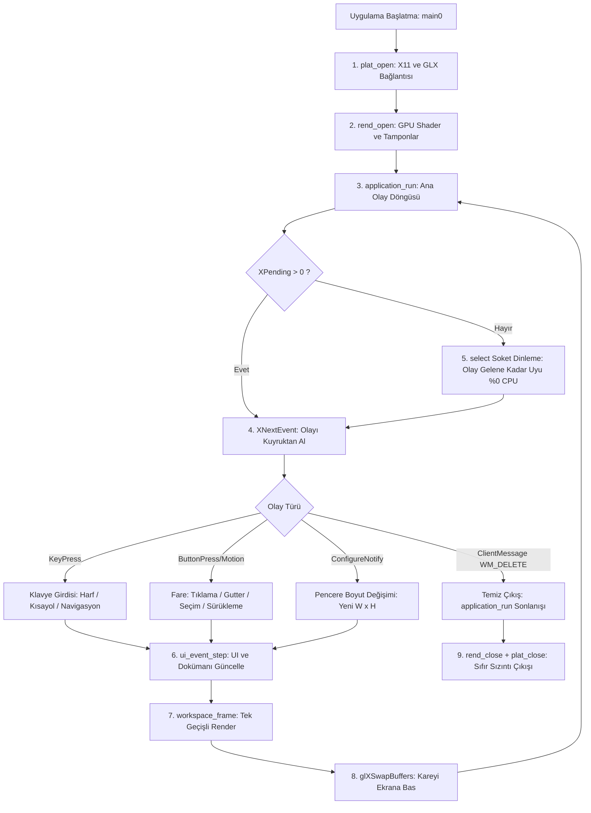

# X11 Platformu ve Uygulama Olay Döngüsü Yeteneği

## 1. Yetenek Özeti ve Sorumluluk Sınırları

Bu yetenek, Anthracite editörünün Linux/X11 pencere sistemiyle olan düşük seviyeli iletişimini, donanım hızlandırmalı OpenGL yüzeyinin ayağa kaldırılmasını, işletim sistemi giriş olaylarının (fare, klavye, pencere boyutu) yakalanmasını ve enerji tasarruflu olay döngüsünü (event loop) yönetir.

Sistemde GLFW, SDL, Qt, GTK veya benzeri hiçbir harici pencereleme kütüphanesi kullanılmaz; doğrudan Xlib / X11 protokolü ve POSIX soket dinleme mekanizmaları (`select` / `poll`) ile çalışılır.

### Temel Sorumluluklar
* **X11 Pencere Yaşam Döngüsü:** Ekran sunucusuna bağlanma (`XOpenDisplay`), görsel konfigürasyon seçimi (`glXChooseVisual`), pencere oluşturma ve `WM_DELETE_WINDOW` protokolüyle temiz kapanış.
* **OpenGL Bağlamı (GLX):** Doğrudan çizim (direct rendering) destekli modern OpenGL bağlamı oluşturma ve pencereye bağlama (`glXMakeCurrent`).
* **Boşta Sıfır CPU Tüketimi (Zero Idle CPU):** Sürekli meşgul döngü (busy polling) yerine; X11 soket dosya tanıtıcısını (`ConnectionNumber(dpy)`) `select` sistem çağrısıyla dinleyerek boşta dururken %0 CPU tüketimi sağlama.
* **Giriş Olaylarının Ayrıştırılması:** Tuş basımı (`KeyPress`), tuş bırakma, fare tıklaması, sürükleme (`MotionNotify`), pencere yeniden boyutlandırma (`ConfigureNotify`).
* **Modifikatör Tuş Çözümleme:** Shift, Control ve Alt (`Mod1Mask` / `mod_alt`) durumlarının formel tip seviyesinde ayrıştırılması.
* **Çalışma Zamanı Selftest Entegrasyonu:** `./build/anthracite --selftest` bayrağı ile uygulamanın tam grafiksel ortamda başlatılıp tüm testlerin otomatik yürütülmesi.

---

## 2. Olay Döngüsü ve Platform Mimarisi



---

## 3. Modül Dosya Yapısı

* `src/core_platform/x11.sats`: X11 platform tipi (`Plat`), olay veri tipleri (`Event`), pencere boyutları ve modifikatör fonksiyonları (`mod_alt`).
* `src/core_platform/x11.dats`: Platform açılış/kapanış akışı, olay kuyruğu süzme ve `select` ile bekleme implementasyonu.
* `src/core_platform/x11.cats`: Yalın Xlib/GLX C başlık bağlayıcıları (`<X11/Xlib.h>`, `<GL/glx.h>`).
* `src/core_runtime/application.sats` & `application.dats`: Uygulama durumu, ana olay döngüsü, kare yenileme ve çıkış orkestrasyonu.
* `src/core_runtime/selftest.sats` & `selftest.dats`: Grafiksel ortamda otomatik test koşturucu ve bellek sızıntısı bütçe kontrolü.

---

## 4. Temel Olay Veri Tipleri ve API İmzaları

### A. Giriş Olayları (`Event`)
```ats
datatype Event =
  | EV_NONE
  | EV_KEY of (int, int)       (* (KeySym, Modifiers) *)
  | EV_MOUSE_DOWN of (int, int, int, int) (* (X, Y, Button, Modifiers) *)
  | EV_MOUSE_UP of (int, int, int)        (* (X, Y, Button) *)
  | EV_MOUSE_MOVE of (int, int)           (* (X, Y) *)
  | EV_RESIZE of (int, int)               (* (Yeni Genişlik, Yeni Yükseklik) *)
  | EV_QUIT                               (* Pencere Kapatma İsteği *)
```

### B. Modifikatör Sabitleri
```ats
fun mod_shift(): int = "mac#anth_mod_shift"
fun mod_ctrl(): int  = "mac#anth_mod_ctrl"
fun mod_alt(): int   = "mac#anth_mod_alt"   (* X11 Mod1Mask *)
```

### C. Platform Fonksiyon İmzaları (`x11.sats`)
```ats
fun plat_open(): Plat
fun plat_close(p: Plat): void
fun plat_ok(p: !Plat): bool
fun plat_next_event(p: !Plat, timeout_ms: int): Event
fun plat_swap_buffers(p: !Plat): void
fun plat_width(p: !Plat): int
fun plat_height(p: !Plat): int
```

---

## 5. Çekirdek Algoritmik Süreçler

### A. Enerji Tasarruflu `select` Bekleme Mekanizması
Modern metin editörleri boştayken gereksiz elektrik tüketmemelidir. Anthracite şu algoritmayı işletir:
```ats
fun plat_wait_event(p: !Plat, timeout_ms: int): bool = let
  val fd = plat_x11_fd(p) (* ConnectionNumber(display) *)
in
  if x11_pending(p) > 0 then true
  else let
    val has_data = posix_select_fd(fd, timeout_ms)
  in
    has_data > 0
  end
end
```
* X11 olay kuyruğunda bekleyen olay varsa derhal işlenir (`x11_pending > 0`).
* Kuyruk boşsa işletim sistemi soketi üzerinden `select` ile uykuya geçilir; CPU kullanımı **%0.0** seviyesine düşer.
* Fare hareket ettiğinde veya tuşa basıldığında çekirdek kesmesiyle uyanılır.

### B. Alt Tuşu ve Modifikatör Tespiti
Gutter katlama oklarında normal tık ile Alt+Tık (derin katlama) ayrımı platform seviyesinde şöyle yapılır:
1. X11 `XKeyEvent` veya `XButtonEvent` içindeki `state` bit maskesi okunur.
2. `x11.cats` içindeki `anth_mod_alt` FFI fonksiyonu `Mod1Mask` değerini döndürür.
3. UI seviyesinde bit mantıksal `AND` işlemiyle Alt tuşunun durumu kontrol edilir:
   ```ats
   val is_alt = iand(ev_mods(ev), mod_alt()) <> 0
   ```

---

## 6. Güvenlik, Hata Yakalama ve Değişmezler

* **X11 Hata İzolasyonu:** Ekran açılamazsa (`plat_open` başarısız) uygulama sessizce çökmez; yapılandırılmış `[ERROR] cannot_open_display` logu basarak sıfır sızıntıyla güvenli çıkış yapar.
* **Temiz Bellek Yaşam Döngüsü:** Uygulama `WM_DELETE_WINDOW` aldığında olay döngüsünden çıkar; `rend_close(r)` ve `plat_close(p)` sırasıyla çalışarak tüm OpenGL ve X11 kaynaklarını serbest bırakır.
* **Selftest Bütçesi:** `runtime_selftest` koşturulduğunda bellek bütçesi doğrulanır (`live=1530113`); grafik belleği ve sistem kaynakları tam olarak iade edilir.
