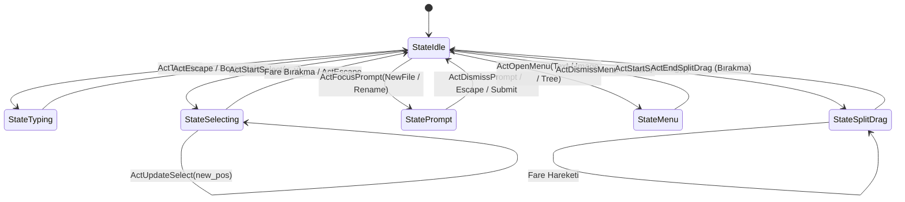

# Kullanıcı Arayüzü (UI), RAD Debugger Mimarisi ve Çalışma Alanı Yeteneği

## 1. Yetenek Özeti ve İlham Kaynağı

Anthracite editörünün kullanıcı arayüzü, görsel bileşenleri ve etkileşim modeli; **RAD Debugger** projesinin (Ryan Fleury, Dion Systems / Epic Games) minimalist, son derece yüksek performanslı ve doğrudan GPU güdümlü arayüz mimarisinden ilham alınarak tasarlanmıştır.

Bu yetenek; geleneksel ağır, web tabanlı veya karmaşık widget hiyerarşisine sahip GUI kütüphaneleri (Electron, Qt, GTK vb.) yerine; saf C/ATS2 ile yazılmış, anında çizim (immediate-mode) felsefesini koruyan, sıfır çöp toplayıcı (zero-GC) maliyetiyle çalışan ve doğrudan OpenGL Core Profile üzerinde çizim yapan askeri düzey bir çalışma alanı sunar.

### Temel Sorumluluklar
* **RAD Debugger Bileşen Kütüphanesi (`ui_widgets.*`):** Kaynak kod kesiti (code slice), kesme noktası (breakpoint) gutter'ı, hiyerarşik ağaç/tablo hücresi (`ui_cell`), yumuşak gölgeli paneller (`ui_pane`), orantılı kaydırma çubukları (`ui_scroll_bar`), tek satırlı metin editörü (`ui_line_edit`) ve modal yükleme pencereleri (`ui_loading_overlay`).
* **Çalışma Alanı ve Dinamik Bölünmüş Ekran (Split View):** Çoklu sekme desteği, sekmelerin yatayda sürükle-bırak ile yeniden sıralanması, sağ üçte birlik alana sürükleyerek dinamik dikey bölünmüş ekran (`SPLIT_VERTICAL`) oluşturma.
* **Yeniden Boyutlandırılabilir Yan Panel (Resizable Sidebar):** 6 piksellik hassas tutamaç (`UI_SIDEBAR_GRAB_WIDTH`) üzerinden farenin yatay sürüklenmesiyle canlı boyutlanan yan panel.
* **İki Katmanlı Sonlu Durum Makinesi (FSM):**
  - **Editör FSM (`editor_fsm.*`):** Modal durumların (`StateIdle`, `StateTyping`, `StateSelecting`, `StatePrompt`, `StateMenu`, `StateSplitDrag`) deterministik ve yarış-durumsuz yönetimi.
  - **Gömülü İçerik FSM (`embed_fsm.*`):** Doküman içi görsellerin ve harici dosyaların dosya zaman damgası (`mtime`) ile asenkron önbellekli yüklenmesi (`EmbedCached`, `EmbedResolving`).
* **Kapsamlı Komut Sistemi (`ui_cmd.*`):** 55'ten fazla atomik klavye/fare komutu, çift modlu düzenleme (`ViewEdit` vs `ViewRead`).
* **Görsel İzdüşüm ve Yumuşak Kaydırma (Soft Wrap Navigation - `visual_*`):** Karakter indeksleri ile 2D piksel koordinatları arasında hatasız çift yönlü izdüşüm ve yumuşak sarılmış satırlarda dikey imleç navigasyonu.

---

## 2. Arayüz Mimarisi ve Görsel Şema

Arayüz; Üst Bar (Top Bar), Yeniden Boyutlandırılabilir Yan Panel (Sidebar), Düzenleyici Tuvali (Editor Canvas) ve dinamik Split View alanından oluşur:

```
+-----------------------------------------------------------------------------------------+
| [Gezgin] [Arama] [Ayar] | [ Sekme 1 (Aktif) x ] [ Sekme 2 x ]    [+]  [Görünüm] [_][O][X] | <- Üst Bar (h=36)
+-------------------------+---------------------------------------------------------------+
| DOSYA GEZGİNİ           |  1 | # Başlık                                              >  |
| > notlar/               |  2 | Bu satır doküman içeriğidir.                             |
|   ├── [F] plan.md       |  3 | - Liste maddesi 1                                     v  | <- Editör Tuvali
|   └── [F] gorevler.md   |  4 |   - Alt madde (girintili)                                |    (Gutter + Metin)
|                         |  5 |                                                          |
|                         |    | (Split View durumunda sağda bağımsız ikinci bir editör)  |
| <-> [Tutamaç: 6px]      |    |                                                          |
+-------------------------+----+----------------------------------------------------------+
| Bilgi Çubuğu: UTF-8 | Satır: 12, Sütun: 4 | live=1530113 | 120 FPS                      |
+-----------------------------------------------------------------------------------------+
```

---

## 3. RAD Debugger İlhamlı Bileşen Kütüphanesi (`ui_widgets.*`)

`src/ui_workspace/ui_widgets.sats` ve `ui_widgets.dats` dosyalarında tanımlanan bileşenler, RAD Debugger'ın ikonik arayüz elemanlarının birebir ATS2 karşılıklarıdır:

### A. `ui_code_slice`: Debugger Kod Kesiti ve Kesme Noktası Gutter'ı
Hata ayıklama veya kod inceleme satırlarını çizer.
* **Gutter Genişliği:** `CODE_GUTTER_WIDTH = 44 px`.
* **Kesme Noktası (Breakpoint):** Satırda kesme noktası varsa (`has_bp = On`), gutter içine 8x8 piksellik dairesel/kare kırmızı belirteç (`col_danger()`) çizilir (`code_breakpoint_dot`).
* **Satır Numaraları:** `format_line_num` ile 4 haneli hizalı satır numarası formatlanır ve `col_muted()` rengiyle sağa dayalı basılır.
* **Durum Vurguları:** Satır aktifse (`is_active = On`) arka plan `col_side()` ile, fare üzerindeyse (`is_hover = On`) `col_bar()` ile renklendirilir; kod metni `col_white()` veya `col_text()` olarak yazılır.

### B. `ui_cell`: RAD Debugger Hiyerarşik Ağaç ve Değer Tablosu Hücresi
RAD Debugger'ın *Watch*, *Locals*, *Call Stack* ve dosya ağacı görünümlerinin temel taşıdır:
* **Çok Seviyeli Girinti ve Kılavuz Çizgileri (`draw_cell_guides`):**
  Her derinlik seviyesi (`depth * 14 px`) için `col_line()` renginde dikey hizalama kılavuz çizgileri çizilir. Böylece derin iç içe geçmiş ağaç yapıları gözle kolayca takip edilir.
* **Genişletici Oku (`ui_expander`):** Düğüm katlanabilir/açılabilir ise aşağı (`UI_ICON_DOWN_ARROW`) veya sağa (`UI_ICON_RIGHT_ARROW`) bakan vektörel ok çizilir.
* **Düğüm Simgesi (`ui_draw_icon`):** Klasör (`UI_ICON_FOLDER`), dosya (`UI_ICON_FILE`), arama (`UI_ICON_SEARCH`) vb. 14 farklı vektörel simgeden biri basılır.
* **Çift Sütunlu Metin ve Akıllı Sığdırma (`fit_str_bytes`):**
  - **Sol Sütun (Label):** Değişken adı, dosya adı veya fonksiyon adı. Sütun genişliğine sığmayan metinler `fit_str_bytes` algoritması ile UTF-8 sınırlarında ölçülerek taşmadan kırpılır.
  - **Sağ Sütun (Value):** Değişken değeri, dosya boyutu veya durum metni (`value_text`), sağ kenara yaslı olarak `col_muted()` ile basılır.
* **Seçim Çubuğu:** Hücre seçildiğinde (`is_selected = On`), sol kenarda 2 piksellik `col_accent()` dikey vurgu çubuğu ve `col_side()` arka planı belirir.

### C. `ui_pane_begin` & `ui_pane_draw_header`: Gölgeli Panel Sistemi
RAD Debugger'ın süzülen veya sabit panel pencereleridir:
* **3 Katmanlı Yumuşak Gölge (`ui_draw_shadow`):**
  - Dış katman: Genişleme +4 px, Alfa: 15 (`SHADOW_ALPHA_OUTER`).
  - Orta katman: Genişleme +2 px, Alfa: 30 (`SHADOW_ALPHA_MID`).
  - İç katman: Genişleme 0 px, Alfa: 50 (`SHADOW_ALPHA_INNER`).
* **Panel Başlığı (`PANE_HEADER_HEIGHT = 28 px`):** Başlık metni `col_heading()`, panel kapatma butonu (`x`), 1 piksellik alt ayırıcı sınır çizgisi.

### D. `ui_scroll_bar`: Orantılı Hassas Kaydırma Çubuğu
* **Eksen Desteği:** `Axis = Horizontal | Vertical`.
* **Dinamik Başparmak:** İçerik uzunluğuna göre orantılı boyutlandırılır; ancak asla `SCROLLBAR_MIN_THUMB = 18 px` değerinin altına inmez.
* **Geri Bildirim:** Boşta `col_line()`, fare üzerinde `col_muted()`, sürüklenirken (`is_dragging = On`) aktif `col_accent()` rengini alır.

### E. `ui_line_edit_draw`: Tek Satırlı Giriş Editörü (Omnibar / Filtre)
* Yer tutucu metin (`placeholder`), odaklanma çerçevesi (`col_accent()`).
* Metin içi seçim aralığı kutusu (`line_edit_selection` -> `col_sel()`).
* Yanıp sönen dikey imleç (`line_edit_caret` -> 2 px genişlik, `col_caret()`).
* Metnin dışarı taşmasını engelleyen donanımsal `rend_scissor` kırpması.

### F. `ui_loading_overlay`: RAD Tarzı Modal İlerleme Kartı
* Tüm ekranı kaplayan yarı saydam koyu örtü (`col_overlay()`).
* Ekranın ortasına yerleşen `380x140 px` boyutunda gölgeli kart.
* İlerleme çubuğu (`ui_loading_track`): 8 px yükseklikte oluk, %0-100 aralığında `col_accent()` dolgusu, modal başlığı ve durum mesajı.

---

## 4. Modül Dosya Yapısı (44 Kaynak Dosyası)

`src/ui_workspace/` dizinindeki tüm bileşenler katı SRP (Tek Sorumluluk Prensibi) ile ayrılmıştır:

```
src/ui_workspace/
├── [Çekirdek & Olay Yönlendirme]
│   ├── ui.sats / ui.dats                     -> Ana UI durumu, fare/klavye olay dağıtımı (137 KB)
│   ├── ui_render.sats / ui_render.dats       -> Tüm arayüzün tek geçişli OpenGL çizimi (104 KB)
│   └── ui_common.sats / ui_common.dats       -> Temel geometriler, boyut makroları, tampon yardımcıları
├── [RAD Debugger Bileşenleri]
│   └── ui_widgets.sats / ui_widgets.dats     -> ui_cell, ui_code_slice, ui_pane, ui_scroll_bar, butonlar
├── [Sekmeler & Split View]
│   └── ui_tab.sats / ui_tab.dats             -> Çoklu sekme modeli, bölünmüş ekran, sürükle-bırak
├── [Durum Makineleri (FSM)]
│   ├── editor_fsm.sats / editor_fsm.dats     -> Modal editör durum makinesi (Idle, Typing, Selecting, Prompt...)
│   └── embed_fsm.sats / embed_fsm.dats/.cats -> Görsel ve gömülü dosya önbellek FSM'si
├── [Komut & Menü Altyapısı]
│   ├── ui_cmd.sats / ui_cmd.dats             -> 55+ atomik editör komutu ve kısayol çözümleme
│   ├── ui_menu.sats / ui_menu.dats           -> Metin, görsel ve dosya ağacı bağlam menüleri, inline promptlar
│   ├── ui_tree.sats / ui_tree.dats           -> Dosya ağacı taranması, dosya oluşturma/silme/yeniden adlandırma
│   └── ui_search.sats / ui_search.dats       -> UI içi arama kutusu ve eşleşme vurgulama
├── [Görsel İzdüşüm & Metin Tuvali (Visual Engine)]
│   ├── visual_paint.sats / visual_paint.dats -> Metin dilimleri, seçim bantları ve satır boyama
│   ├── visual_query.sats / visual_query.dats -> 2D pikselden karakter ofsetine (hit-test) izdüşümü
│   ├── visual_navigation.sats / .dats        -> Yumuşak sarılmış (wrap) satırlarda dikey imleç adımı
│   ├── visual_decor.sats / visual_decor.dats -> Başlık ve liste arka plan/ayırıcı dekorasyonları
│   ├── visual_projection.dats                -> Boyut ve koordinat dönüştürücüleri
│   ├── visual_wrap.dats                      -> Görsel satır sarma sınırları
│   └── visual_layout.sats / _prepare.dats    -> Görsel yerleşim hazırlık geçişi
└── [Gömülü Doküman & Metin Köprüsü]
    ├── embedded_doc.sats / embedded_doc.dats -> İç içe doküman nesneleri
    ├── source_navigation.sats / .dats        -> Kaynak kod ofset yönlendirmesi
    ├── ui_text_engine.sats / .dats           -> data_text ile UI arasındaki köprü
    └── ui_wrap_marker.dats                   -> Satır sonu sarma belirteçleri
```

---

## 5. İki Katmanlı Sonlu Durum Makinesi (FSM) Mimarisi

Arayüzün kararlılığı, hiçbir zaman belirsiz ara durumlara (undefined state) düşmeyen iki formel FSM ile sağlanır:

### A. Editör Etkileşim FSM'si (`editor_fsm.*`)



* **Modal Kilitleme (`editor_fsm_is_modal`):**
  Editör `StatePrompt` veya `StateMenu` durumundayken modal kilitleme devreye girer. Arka plandaki tuval tıklamaları ana dokümana yazı yazamaz; tüm olaylar ön plandaki aktif menü veya prompt girişine yönlendirilir.

### B. Gömülü İçerik ve Canlı Doküman (Transclusion) Önbelleği (`embed_fsm.*` & `ui_render.dats`)

Doküman içindeki `` ve gömülü notların (`![[not]]`) işlenmesi sıfır kare-başına I/O mimarisiyle çalışır:
1. `EmbedUnloaded`: Henüz yüklenmemiş görsel veya transclusion.
2. `EmbedResolving`: Görsel boyutu ve pikselleri okunuyor.
3. `EmbedCached(h)`: Görsel veya gömülü doküman belleğe yüklendi, dokümandaki dikey yüksekliği ($h$) sabitlendi.
4. `EmbedFailed`: Dosya bulunamadı veya bozuk (kırmızı hata ikonu basılır).
* **Mtime Doğrulaması:** Dosyanın diskteki değiştirilme zamanı (`st_mtime` / `fs_mtime`) izlenir; dosya güncellendiğinde önbellek otomatik olarak geçersiz kılınır.
* **Canlı Doküman LRU Önbelleği (`CEmbed` in `Cache`):**
  - Gömülü notlar (`![[not]]`), her render karesinde diskten okunup yeniden ayrıştırılmak yerine `datavtype Cache` içindeki `CEmbed of (Buf, int, Doc, int, int, Cache)` yapıcılarında hazır AST ve layout'u ile canlı tutulur.
  - `cache_take_embed` ile `Doc` lineer olarak ödünç alınıp çizilir ve `cache_put_embed` ile 48 yuvalı LRU kuyruğuna geri bırakılır.
  - Tahliye edilen veya kapatılan belgeler `doc_free` ile derhal serbest bırakılarak `live=1530113` bellek değişmezi korunur.
  - Bu sayede onlarca transclusion içeren `vird.md` gibi notlarda kare başına disk okuması ve markdown parsing maliyeti **0'a** indirilir.

---

## 6. Dinamik Split View ve Sekme Yönetimi (`ui_tab.*`)

Anthracite, birden fazla dokümanla aynı anda çalışabilmek için esnek bir bölünmüş ekran modeline sahiptir:

```ats
datatype TabSplit =
  | SPLIT_NONE              (* Tek editör tam genişlikte *)
  | SPLIT_VERTICAL of int   (* Dikey bölme oranı, piksel ofseti *)
```

### Bölünmüş Ekran Oluşturma Akışı
1. Kullanıcı aktif sekme başlığını fare ile tutar (`DragTab`).
2. Sekme pencerenin sağ üçte birlik bölgesine (`drag_x > width * 0.7`) sürüklendiğinde ekran otomatik olarak ikiye ayrılır (`SPLIT_VERTICAL`).
3. Sağ bölmede sürüklenen sekme açılır; sol bölmede önceki sekme kalır.
4. **Bağımsız Durum:** Her iki bölme tamamen bağımsız kaydırma pozisyonuna (`scroll_y`), imleç konumuna, seçim aralığına ve katlama görünürlüğüne sahiptir.
5. Kullanıcı ortadaki 6 piksellik dikey ayırıcı çizgiyi tutarak sağ ve sol panellerin genişlik oranını dilediği gibi değiştirebilir (`StateSplitDrag`).

---

## 7. Kapsamlı Komut ve Kısayol Haritası (`ui_cmd.*`)

Editörde tüm klavye ve menü aksiyonları 55'ten fazla tür-güvenli `Cmd` atomuna çözümlenir:

| Kategori | Komutlar (`Cmd`) | Klavye Kısayolu |
|---|---|---|
| **İmleç Hareketi** | `CMD_CARET_LEFT/RIGHT/UP/DOWN`<br>`CMD_CARET_LINE_START/END`<br>`CMD_DOC_START/END`<br>`CMD_PAGE_UP/DOWN` | Yön Tuşları<br>Home / End<br>Ctrl+Home / Ctrl+End<br>PageUp / PageDown |
| **Kelime Navigasyonu** | `CMD_WORD_LEFT / CMD_WORD_RIGHT`<br>`CMD_DELETE_WORD_LEFT/RIGHT` | Ctrl+Sol / Ctrl+Sağ<br>Ctrl+Backspace / Ctrl+Delete |
| **Metin Seçimi** | `CMD_SELECT_ALL`<br>`CMD_SELECT_LEFT/RIGHT/UP/DOWN`<br>`CMD_SELECT_WORD_LEFT/RIGHT` | Ctrl+A<br>Shift + Yön Tuşları<br>Ctrl+Shift + Sol/Sağ |
| **Pano & Düzenleme** | `CMD_CUT / CMD_COPY / CMD_PASTE`<br>`CMD_UNDO / CMD_REDO`<br>`CMD_SAVE` | Ctrl+X / Ctrl+C / Ctrl+V<br>Ctrl+Z / Ctrl+Y<br>Ctrl+S |
| **Markdown Sarıcılar** | `CMD_WRAP_BOLD` (`**metin**`)<br>`CMD_WRAP_ITALIC` (`*metin*`)<br>`CMD_WRAP_WIKILINK` (`[[not]]`) | Ctrl+B<br>Ctrl+I<br>Ctrl+K |
| **Sekme & Çalışma Alanı**| `CMD_NEW_TAB / CMD_CLOSE_TAB`<br>`CMD_NEXT_TAB / CMD_PREV_TAB`<br>`CMD_TOGGLE_VIEW` (Edit/Read) | Ctrl+T / Ctrl+W<br>Ctrl+Tab / Ctrl+Shift+Tab<br>Ctrl+E |
| **Dosya & Arama** | `CMD_OPEN_SEARCH`<br>`CMD_NEW_FILE / CMD_NEW_FOLDER` | Ctrl+F<br>Ctrl+N / Ctrl+Shift+N |

---

## 8. Görsel İzdüşüm ve Yumuşak Satır Kaydırma (Soft Wrap Engine)

Metin tuvali, tek satırlık paragrafların pencere genişliğine göre görsel olarak alt satırlara kırıldığı durumlarda (soft wrap) şu ileri düzey izdüşümleri işletir:

1. **`visual_query.dats` (`visual_click_source`):**
   Kullanıcı fareyle ekranda herhangi bir $(X, Y)$ koordinatına tıkladığında; kaydırma (`scroll_y`), gutter genişliği, font satır yüksekliği (`line_h`) ve glif genişlikleri taranarak tek bir tıklamayla dokümandaki kesin karakter bayt ofseti bulunur ($O(\log N)$ bisection ile).
2. **`visual_navigation.dats` (`tabs_visual_vertical`):**
   Aşağı/Yukarı yön tuşlarına basıldığında, imleç mantıksal bir sonraki `\n` satırına atlamaz. Eğer mevcut paragraf 4 görsel satıra sarılmışsa, görsel olarak tam bir alt sütuna geçer; sütun hizasını korur.
3. **`visual_paint.dats`:**
   Seçili metin blokları (`visual_draw_selection`), sarılmış satırların her birinde ayrı ayrı kesintisiz dikdörtgen bantlar (`visual_draw_band`) olarak çizilir.
4. **`visual_wrap.dats` (`advance_wrap_cursor` & `block_kind_at`):**
   Monotonik süpürme imleci ile her satırda tüm AST düğümlerini $O(L \times N)$ baştan taramak yerine; süresi geçmiş düğümler `doc_node_end <= pos` kuralıyla atlanır ve `doc_node_start > pos` olduğu anda arama durdurulur. Bu sayede $O(L + N)$ tek geçişli sarma genişliği (`line_target_width_kind`) hesaplanır.

---

## 9. Performans, Güvenlik ve Bellek Değişmezleri

* **Tek Geçişli GPU Render:** Her karede arayüz hiyerarşisi yeniden oluşturulmaz; tüm elemanlar `ui_render.dats` içinde tek bir derinliksiz geçişle doğrudan VBO/VAO üzerinden GPU'ya aktarılır.
* **Scissor Kırpması:** Panellerin ve metin girişlerinin dışına taşan içerikler GPU seviyesinde `glScissor` ile anında kesilir; CPU yükü oluşturmaz.
* **Monotonik $O(L + N)$ Ölçeklenebilirlik:** Uzun dosyalarda (ör. `söz.md` - 806 satır, 3.406 düğüm) yerleşim ve sarma karesel karmaşıklıktan kurtarılarak açılış ve katlama süresi **0.2 saniyeye** indirilmiştir.
* **Sıfır Per-Frame I/O & Canlı Transclusion Önbelleği:** 37+ embed içeren `vird.md` gibi dosyalarda her karede disk okuma ve markdown ayrıştırma sıfırlanmış; canlı `Doc` LRU önbelleği (`CEmbed`) ile render süresi **5 ms** seviyesine çekilmiştir.
* **Boşta Sıfır CPU (%0 CPU Invariant):** Kullanıcı fareyi oynatmadığı veya klavyeye basmadığı sürece olay döngüsü X11 soketi üzerinde `select` ile bekler; gereksiz kare çizilmez.
* **Bellek Değişmezi:** Tüm sekmeler, dosya ağacı tamponları ve geçici çizim tamponları kapandığında bellek iade edilir. `./build/anthracite --selftest` testinde `live=1530113` değişmezi tam olarak korunur.
