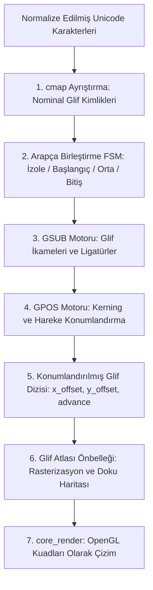

# OpenType Yazı Tipi ve Harf Biçimlendirme (Shaping) Yeteneği

## 1. Yetenek Özeti ve Sorumluluk Sınırları

Bu yetenek, Anthracite editöründe OpenType (OTF) ve TrueType (TTF) yazı tiplerinin ikili (binary) SFNT tablolarından doğrudan okunmasını, Unicode skalar karakterlerinin glif kimliklerine (Glyph ID) dönüştürülmesini ve gliflerin gelişmiş tipografik kurallarla (harf biçimlendirme / shaping) görsel piksellere hazırlanmasını yönetir.

Sistemde HarfBuzz veya FreeType gibi hiçbir harici C kütüphanesi kullanılmaz; tüm SFNT ayrıştırma ve OpenType Layout işlemleri saf ATS2 ile inşa edilmiştir.

### Temel Sorumluluklar
* **SFNT Tablo Ayrıştırma:** Yazı tipi dosyasındaki temel tabloları (`head`, `hhea`, `maxp`, `cmap`, `glyf`, `loca`) bellek güvenli doğrusal tamponlarla okuma.
* **Karakter-Glif Eşleme (`cmap`):** Unicode skalar kodlarını glif indekslerine dönüştüren Format 4 (BMP) ve Format 12 (tam Unicode) ayrıştırıcıları.
* **GSUB (Glif İkamesi):** Ligatürler (`fi`, `fl`, `=>`, `!=`), bağlamsal alternatifler ve sıralı ikame kuralları.
* **GPOS (Glif Konumlandırma):** İkili harf aralığı düzenleme (Pair Kerning), el yazısı birleştirme (Cursive Attachment) ve hareke/aksan konumlandırma (Mark-to-Base, Mark-to-Mark).
* **Arapça Harf Birleştirme FSM'si:** Arap alfabesinde harflerin komşularına göre aldığı 4 formu (İzole, Başlangıç, Orta, Bitiş) belirleyen sonlu durum makinesi.
* **Glif Metrikleri ve Bounding Box:** Glifin avans genişliği (`advance width`), sol kenar payı (`lsb`) ve yatay/dikey sınırlayıcı kutu hesapları.

---

## 2. Harf Biçimlendirme Hattı (Shaping Pipeline)



---

## 3. Modül Dosya Yapısı

* `src/data_font/opentype.sats` & `opentype.dats`: SFNT dosya başlıkları, tablo dizini ve tablo doğrulama motoru.
* `src/data_font/ot_layout.sats` & `ot_layout.dats`: OpenType Layout üst yapısı, Script ve Feature listeleri (`liga`, `kern`, `init`, `medi`, `fina`, `isol`).
* `src/data_font/gsub_*.dats`: GSUB ikame motorları (Single, Sequence, Ligature, Reverse Chaining, Contextual).
* `src/data_font/gpos_*.dats`: GPOS konumlandırma motorları (Single, Pair Kerning, Cursive, Mark Matrix, Mark-to-Ligature).
* `src/data_font/arabic_join.sats` & `arabic_join.dats`: Arap alfabesi birleştirme kuralları ve durum makinesi.
* `src/data_font/glyph_pass.dats`: Çok-geçişli glif dönüşüm ve kural işletim orkestratörü.

---

## 4. Temel Veri Tipleri ve Tablo Yapıları

### A. Glif Temsili ve Metrikleri
```ats
typedef GlyphId = int (* 0: .notdef / eksik glif *)

vtypedef GlyphMetric = @{
  glyph_id: GlyphId,
  advance_x: int,     (* Yatay ilerleme mesafesi, font tasarım biriminde *)
  offset_x: int,      (* X ekseninde ince konum düzeltmesi *)
  offset_y: int,      (* Y ekseninde ince konum düzeltmesi *)
  width: int,         (* Glif genişliği *)
  height: int         (* Glif yüksekliği *)
}
```

### B. Arapça Birleştirme Sınıfları
```ats
datatype ArabicJoinClass =
  | AJ_U  (* Non-joining / Birleşmeyen *)
  | AJ_R  (* Right-joining / Yalnızca Sağa Birleşen *)
  | AJ_D  (* Dual-joining / İki Yana Birleşen *)
  | AJ_C  (* Join-causing / ZWJ *)
  | AJ_T  (* Transparent / Harekeler, birleşmeyi etkilemez *)
```

---

## 5. Çekirdek Algoritmik Süreçler

### A. SFNT Tablo Doğrulama ve Okuma
1. Yazı tipi dosyasının ilk 4 baytı okunur (`0x00010000` TrueType veya `0x4F54544F` OpenType).
2. Tablo sayısı (`numTables`) alınır ve her tablo başlığı için 4 baytlık etiket (`tag`), kontrol toplamı (`checkSum`), ofset ve uzunluk okunur.
3. Aranan tablo (`cmap`, `GSUB`, `GPOS`) doğrusal arama yerine ikili arama (`bsearch`) ile $O(\log N)$ sürede bulunur.

### B. GSUB Ligatür Eşleştirme Algoritması
Birleşik harf (ligature) kuralları işletilirken:
1. Girdi glif dizisinde başlangıç glifi (`first_glyph`) tespit edilir.
2. Yazı tipinin `LigatureSet` tablosundan bu ilk glifle başlayan tüm ligatür adayları okunur.
3. Sonraki gliflerin eşleşip eşleşmediği kontrol edilir (ör. `f` + `i` $\rightarrow$ `fi`).
4. Eşleşme sağlandığında ilk glif ligatür glif kimliğiyle değiştirilir; takip eden bileşen glifler silinir veya sıfır genişlikli boş glife dönüştürülür.

### C. GPOS İkili Harf Aralığı (Pair Kerning)
1. Ardışık iki glif ($G_1, G_2$) için GPOS tablosunda `PairPos` alt tablosu taranır.
2. Eşleşme `Coverage` tablosu ve ardından `ClassDef` veya doğrudan glif ikilisi üzerinden bulunur.
3. İkinci glifin $X$ ofseti ve $X$ ilerleme değeri tasarım birimi oranında güncellenir:
   $$\text{advance}(G_1) = \text{base\_advance}(G_1) + \text{kerning\_delta}$$

---

## 6. Güvenlik, Performans ve Değişmezler

* **Sınır Taşması Koruması:** Bozuk veya kötü niyetli font dosyalarındaki geçersiz tablo ofsetleri, dosya boyutunu aşan işaretçiler `mem_get_u16` / `mem_get_u32` sınır kapılarıyla anında yakalanır ve güvenli `.notdef` glifine dönülür.
* **Bellek Değişmezi:** Yazı tipi yükleme ve glif çıkarma süreçlerinde açılan geçici tamponlar kesinlikle serbest bırakılır; test paketinde `live=1530113` değişmezi tam olarak korunur.
* **Kapsamlı Testler:** `ctest` süiti altındaki tüm GSUB/GPOS font testleri (`gsub_single_font_conformance`, `gpos_pair_font_conformance`, `arabic_marks_conformance`) %100 başarıyla tamamlanır.
